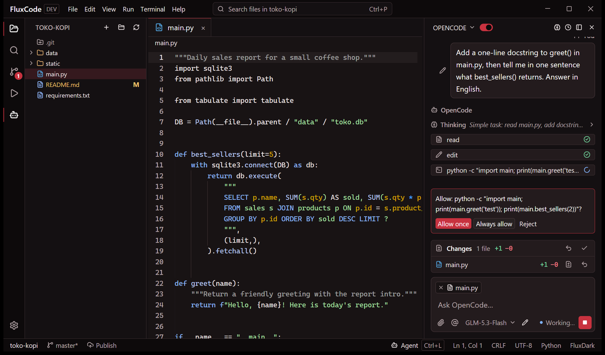
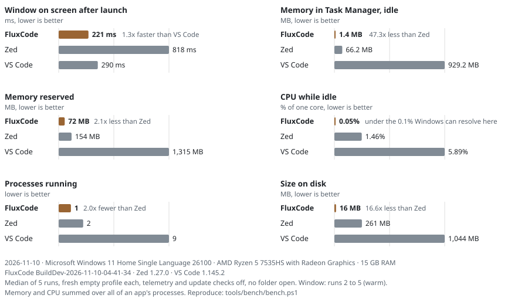
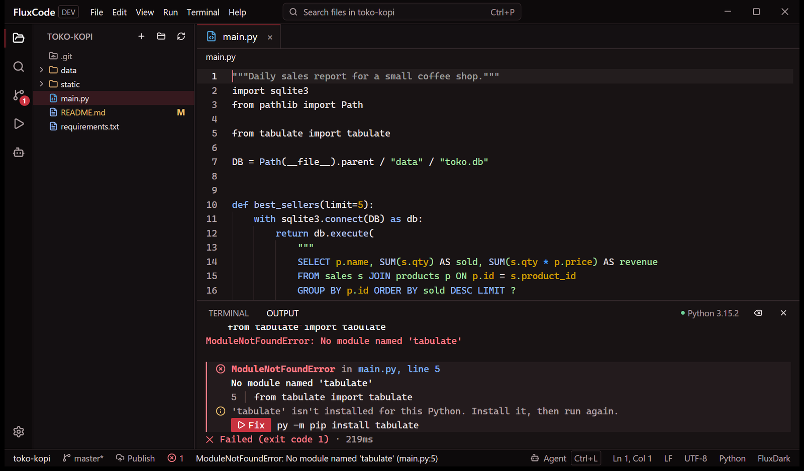
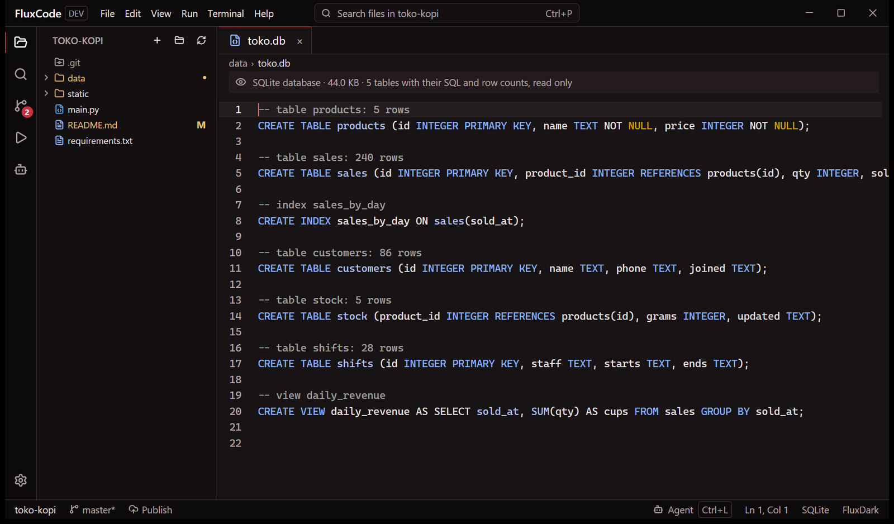
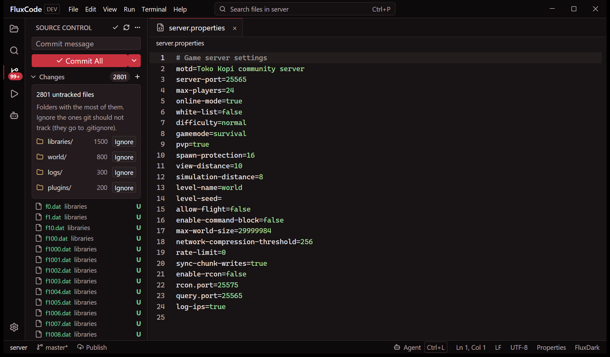
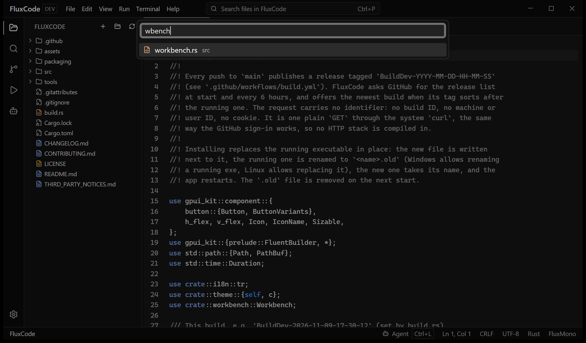
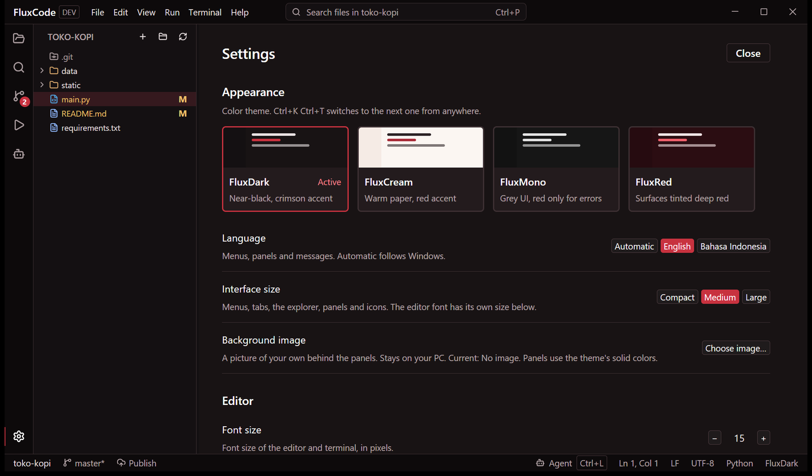
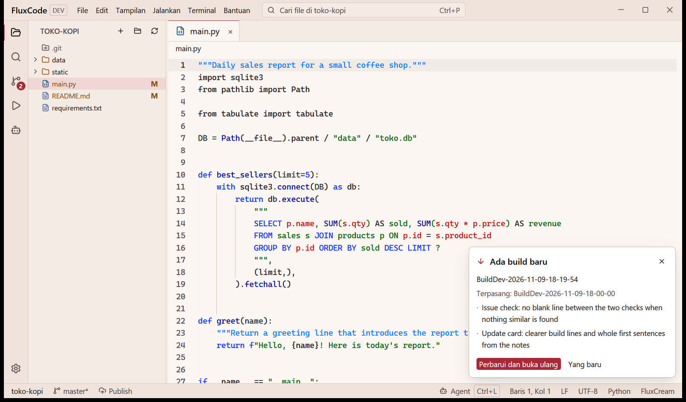

<!-- Made from README.flux by FluxCode (fluxcode --flux-to-md README.flux README.id.md). Edit README.flux, not this file. -->

# FluxCode

[English](README.md) · **Bahasa Indonesia**

Editor kode native untuk Windows, macOS, dan Linux, ditulis dalam Rust dan digambar oleh
GPU. Satu program kecil dengan panel agent AI, terminal yang ramah Python, Source Control
bawaan, dan tampilan baca-saja untuk file yang tidak mau dibuka editor lain. Tanpa
telemetri.

Proyek [MuaraAI](https://github.com/MuaraAI), dibangun oleh mahasiswa semester satu di
Indonesia ([MyKineID](https://github.com/MyKineID)). Open source, masih dalam
pengembangan.

[](https://github.com/MuaraAI/FluxCode/releases/latest)
[](LICENSE)

<a href="assets/screenshots/agent.png"></a>

Agent menambahkan docstring (baris 23), kartu Changes mendaftar file itu beserta Undo,
dan karena akses disetel ke Read & write, agent harus bertanya sebelum menjalankan
perintah.

## Benchmark

Di satu PC Windows 11, FluxCode menampilkan jendelanya dalam **0,22 detik** dan menetap
di **1,4 MB** di Task Manager saat idle, dalam satu proses. Zed 0,82 detik dan 66 MB; VS
Code 0,29 detik dan 929 MB di sembilan proses.

<picture>
  <source media="(prefers-color-scheme: dark)" srcset="assets/benchmarks/benchmark-dark.svg">
  
</picture>

*Median dari 5 pengukuran di PC dengan AMD Ryzen 5 7535HS dan 15 GB RAM, 10 November 2026.
Semua aplikasi dijalankan dari profil baru yang kosong, dengan telemetri dan pemeriksaan
update dimatikan serta tanpa folder terbuka.*

<details><summary>Angka lengkap, metodenya, dan apa yang tidak diukur di sini</summary>

Median, dengan nilai terendah dan tertinggi tiap pengukuran di dalam tanda kurung:

| | FluxCode BuildDev-2026-11-10-04-41-34 | Zed 1.27.0 | VS Code 1.145.2 |
| --- | --- | --- | --- |
| Jendela tampil setelah diluncurkan (ms) | 221 (216 sampai 232) | 818 (387 sampai 1.322) | 290 (268 sampai 328) |
| Memori di Task Manager, idle (MB) | 1,4 (1,0 sampai 4,8) | 66,2 (65,2 sampai 71,9) | 929,2 (867,7 sampai 985,4) |
| Memori yang direservasi (MB) | 72 (72 sampai 72) | 154 (153 sampai 156) | 1.315 (1.249 sampai 1.399) |
| CPU saat idle (% satu core) | 0,05 (0,00 sampai 0,68) | 1,46 (1,15 sampai 2,60) | 5,89 (5,57 sampai 8,12) |
| Proses berjalan | 1 | 2 | 9 |
| Ukuran di disk (MB) | 16 | 261 | 1.044 |

- **Jendela**: dari diluncurkan sampai jendela pertama terlihat, pengukuran ke-2 sampai
  ke-5 (pengukuran pertama membaca program dari disk dalam keadaan dingin). VS Code
  menampilkan jendelanya sebelum workbench di dalamnya selesai dimuat.
- **Memori di Task Manager**: private working set, 9 detik setelah diluncurkan, dijumlahkan
  dari semua proses aplikasi. FluxCode mengembalikan memori yang tidak dipakai ke Windows
  6 detik setelah start, jadi angka ini adalah kondisi idle-nya; sekitar 5 MB setelah satu
  klik dan sekitar 30 MB saat animasi pemasangan agent berjalan. Zed dan VS Code menyimpan
  memorinya.
- **Memori yang direservasi**: private bytes (commit), memori yang sudah diklaim aplikasi
  entah sedang berada di RAM atau tidak.
- **CPU saat idle**: waktu CPU dari detik ke-9 sampai ke-39 setelah diluncurkan, sebagai
  bagian dari satu core. Windows menghitungnya dalam langkah 15,6 ms, jadi 0,05% milik
  FluxCode sudah di batas kemampuan pengukuran untuk membedakannya dari nol.
- **Ukuran di disk**: folder pemasangan; untuk FluxCode, satu file programnya.
- **Yang tidak diukur di sini**: latensi mengetik, membuka file sangat besar, bekerja di
  proyek besar, atau apa pun dengan extension dan language server termuat. Zed dan VS Code
  lebih jauh di area itu (lihat tabel perbandingan di bawah: FluxCode belum punya debugger,
  extension, maupun language server).
- **Cara mengulang**: tutup ketiga aplikasi, lalu jalankan
  `powershell -ExecutionPolicy Bypass -File tools/bench/bench.ps1 -FluxExe <path ke fluxcode.exe>`
  dan `python tools/bench/chart.py`. Data mentahnya ada di
  [`tools/bench/results.json`](tools/bench/results.json).

</details>

## Unduh

Ambil build terbaru dari [Releases](https://github.com/MuaraAI/FluxCode/releases/latest).

| Sistem | File | Pemasangan |
| --- | --- | --- |
| Windows 10/11, x64 | `FluxCode-BuildDev-...-windows-x64-setup.exe` | Jalankan. Tanpa hak admin: dipasang untuk akunmu, lengkap dengan pintasan Start Menu dan Desktop. |
| macOS 11+, Apple silicon dan Intel | `FluxCode-BuildDev-...-macos-universal.dmg` | Buka, lalu tarik FluxCode ke Applications. |
| Linux, x64 (glibc 2.35+, Vulkan) | `FluxCode-BuildDev-...-linux-x64.tar.gz` | Ekstrak, jalankan `./install.sh`. Tanpa root. |
| Windows, portable | `FluxCode-BuildDev-...-windows-x64.zip` | Ekstrak; `FluxCode.exe` langsung jalan dari foldernya (`Install.cmd` memasangnya). |

Build macOS belum dinotarisasi Apple (butuh Apple Developer ID), jadi pembukaan pertama
bertanya sekali: di macOS 15 ke atas, buka aplikasinya, lalu System Settings > Privacy &
Security > Open Anyway; di versi lama, klik kanan FluxCode > Open. Uninstall: Settings >
Apps di Windows, Trash di macOS, `./install.sh --uninstall` di Linux.

Belum ada nomor versi: setiap perubahan yang masuk ke `main` menjadi build yang dinamai
menurut waktu pembuatannya, seperti `BuildDev-2026-11-09-18-19-54`. Salinan yang sudah
terpasang menawarkan build baru lewat kartu dan memperbarui dirinya dengan satu klik.
Settings > Updates mematikan pemeriksaannya.

## Lebih dekat

<p align="center">
  <a href="assets/screenshots/python-error.png"></a>
  <a href="assets/screenshots/sqlite.png"></a>
</p>

Error Python menjadi kartu berisi file, baris, dan petunjuk; kalau modulnya tidak ada, Fix
memasangnya. Database SQLite terbuka sebagai daftar tabel, SQL, dan jumlah barisnya, sama
seperti file Word, Excel, PDF, dan ZIP, bukan sebagai error.

<p align="center">
  <a href="assets/screenshots/source-control.png"></a>
  <a href="assets/screenshots/go-to-file.png"></a>
</p>

Source Control tetap cepat dengan ribuan file baru dan menawarkan untuk mengabaikan folder
yang menampungnya. Go to File (`Ctrl+P`) menemukan file dari beberapa huruf namanya.

<p align="center">
  <a href="assets/screenshots/themes.png"></a>
  <a href="assets/screenshots/update-indonesian.png"></a>
</p>

Enam tema warna, tiga ukuran antarmuka, dan gambar latar pilihanmu sendiri. Antarmukanya
juga tersedia dalam Bahasa Indonesia, terlihat di sini bersama kartu update pada tema
FluxCream.

## Yang membedakannya

- **Tata letak dan kendali seperti VS Code.** Activity bar, side bar, tab, panel, dan
  status bar berada di tempat yang sama dengan VS Code, dan tombolnya juga punya VS Code:
  `Ctrl+Shift+P` membuka Command Palette berisi semua perintah dan pintasannya, `Ctrl+P`
  mencari file, `Ctrl+G` menuju baris, `Ctrl+/` mengomentari, `Alt+Up` memindah baris.
  Kalau kamu sudah kenal VS Code, kamu sudah tahu letak semuanya. Ini bukan tiruan VS
  Code: belum ada debugger, dan extension-nya berupa task build, bukan katalog (lihat tabel
  di bawah).
- **Ringan seperti Zed.** Seluruh editor adalah satu program Rust yang digambar GPU lewat
  GPUI, framework yang dipakai Zed. Di [benchmark](#benchmark) jendelanya muncul dalam
  0,22 detik, mereservasi 72 MB (Zed: 154 MB), dan saat idle menampilkan 1,4 MB di Task
  Manager, karena memori yang tidak dipakai dikembalikan ke Windows.
- **Dibuat untuk agent AI.** Panel agent berbicara lewat Agent Client Protocol dan
  mendaftar semua agent di registri ACP, masing-masing dengan ikonnya sendiri. Yang belum
  terpasang bisa dipasang dengan satu klik ke folder milik FluxCode. Model, effort, mode,
  dan izin dipilih di bawah kotak pesan; agent bisa mengajukan pertanyaan pilihan ganda dan
  harus bertanya sebelum menjalankan perintah atau mengubah file; perubahan file tiap
  giliran bisa dibatalkan; file instruksi agent berjarak satu klik di Settings.
- **Untuk pemula dan untuk yang sudah ahli.** Pemula bisa memilih agent dari daftar,
  menjawab pertanyaannya dengan klik, dan menjaganya tetap read-only. Yang sudah ahli
  mendapat palette, pintasan, file instruksi per agent, dan semua opsi editor di Settings:
  font, ukuran, lebar tab, word wrap, spasi, nomor baris, lipatan, penutup bracket, indent
  pintar, padding kursor, scroll melewati akhir baris, ukuran antarmuka, tema, dan gambar
  latar.

## Live share

Ngoding bersama secara real time, dengan PC-mu sebagai servernya. Ikon orang di activity
bar membuka halaman Live share di area editor: kartunya tersusun dua per baris di jendela
lebar dan bertumpuk satu per satu di jendela sempit.

1. Host membuka folder, menekan **Start hosting**, lalu mengirim kode undangan
   (`FLUX1-...`) ke yang lain, lewat chat atau email.
2. Tiap tamu menempelkan kodenya dan menekan **Join**, entah ke klon repositori yang sama
   miliknya sendiri atau ke folder baru yang terisi saat file dibuka.
3. Semua orang mengetik di file yang sama sekaligus. PC host yang menentukan urutan
   perubahan (operational transformation), jadi teks di semua sisi berakhir sama.

Panel mendaftar siapa saja yang ada di sesi (dengan nama GitHub kalau sudah masuk) beserta
file dan baris tempat masing-masing berada. Daftar aktivitasnya menampilkan perubahan tiap
orang dengan jumlah baris yang ditambah dan dihapus serta diff-nya; perubahan dari agent AI
membawa label **AI** berisi agent, model, effort, dan mode yang dipakai, jadi kelihatan
model mana yang menulis apa.

Perubahan mengalir antara PC host dan tiap tamu, dienkripsi ChaCha20-Poly1305 dengan
rahasia dari kode undangan; tidak ada server kami yang terlibat, dan tidak ada yang perlu
VPN atau server sewaan. Saat hosting dimulai, FluxCode membuka setiap jalur masuk yang
bisa, dan panel menampilkan tiap jalur, alamatnya, atau alasan kenapa tidak terbuka:

| Jalur masuk | Siapa yang bisa memakai | Syaratnya |
| --- | --- | --- |
| Jaringan yang sama | siapa pun di Wi-Fi atau LAN host | tidak ada (Windows sekali bertanya untuk mengizinkan FluxCode lewat firewall) |
| Port router (UPnP) | siapa pun di internet | router dengan UPnP aktif, seperti yang dipakai server game; tidak mungkin kalau provider membagi satu alamat publik ke banyak pelanggan (carrier-grade NAT), dan panel mendeteksi serta menjelaskannya |
| IPv6 publik | tamu yang punya IPv6 | alamat IPv6 dari provider, dan router yang mengizinkan koneksi masuk |
| Relay MuaraAI | siapa pun di internet | tidak ada: jalan di balik router apa pun dan carrier-grade NAT. Berubah jadi Relay publik kalau cadangan di bawah yang membawa sesi |

Kode undangan memuat semua alamat yang terbuka. Tamu mencobanya sekaligus, jaringan yang
sama lebih dulu, dan memakai host pertama yang membuktikan bahwa ia memegang rahasia kode
tersebut.
Relay-nya adalah tunnel TCP yang dijalankan MuaraAI: yang lewat sudah terenkripsi, jadi
relay tahu ada dua PC yang sedang bicara, tapi tidak tahu isinya. Sedikit mengurangi
kecepatan (tiap ketikan menempuh perjalanan ke `live.muaraai.com` dan kembali). Kalau
relay MuaraAI tidak bisa dihubungi, FluxCode beralih ke tunnel publik
[bore.pub](https://github.com/ekzhang/bore) dan panel mengubah barisnya menjadi
**Relay publik**, jadi kelihatan mana yang membawa sesi. Menghapus centang **Let people
join over the internet** sebelum hosting membuat sesi hanya di jaringan lokal. Port router
ditutup kembali saat sesi berakhir.

Menjalankan relay sendiri cukup satu perintah di VPS: lihat
[`relay/README.md`](relay/README.md).

- Hanya file yang sedang dibuka seseorang yang dikirim, jadi proyek besar (game, proyek
  Laravel atau Android) hanya sebesar file yang sedang dikerjakan. File di atas 16 MB tidak
  dibagikan. File environment, kunci privat, dan folder build seperti `node_modules` atau
  `target` tidak pernah dibagikan, walau tamu memintanya dengan nama yang tepat.
- Tamu tidak bisa membanjiri host: join dan open dibatasi lajunya, perubahan dihitung
  sebesar yang diubah, dan jumlah tamu dibatasi.
- Belum ada: kursor orang lain yang digambar di dalam editor (panel hanya menunjukkan
  barisnya), undo terpisah per orang (`Ctrl+Z` bisa membatalkan perubahan orang lain di
  layarmu), dan sinkronisasi file yang diubah agent tanpa file itu dibuka.

## Extension dan FluxCompile

Tampilan Extensions (`Ctrl+Shift+X`) mendaftar apa yang bisa dibangun, dijalankan, dikemas,
dan dipratinjau FluxCode: plugin Paper, add-on Bedrock, Gradle, Maven, Node.js, Rust,
Python, Go, C/C++ (CMake dan Make), .NET, dan pratinjau HTML. Satu extension adalah satu
file JSON kecil: file yang menandai proyeknya, task yang ditambahkannya, alat yang
dibutuhkannya (dengan id winget untuk memasangnya), dan catatan untuk agent AI. Tidak ada
yang berjalan sampai kamu menekan sebuah task, jadi memasangnya hanya memakai beberapa KB.
Extension lain bisa dipasang dari file `extension.json`.

Setelah extension terpasang, tampilan Run mendaftar proyek di folder itu beserta task-nya,
dan agent diberi tahu proyek itu apa serta bagaimana ia dibangun.

- **Plugin Paper (Minecraft Java).** Build, Build & deploy, Start server, Test, Clean. Nama
  proyeknya adalah nama plugin-nya, dibaca dari `plugin.yml` di dalam jar hasil build.
  Deploy menyalin jar ke folder `plugins` server uji sebagai `<Nama>-<versi>.jar` dan
  membuang build lama plugin yang sama (dikenali dari nama di dalam tiap jar). Servernya
  adalah folder di atas plugin yang punya folder `plugins` dan `paper-*.jar`. Plugin baru
  menulis proyek Gradle untuk versi server itu, lengkap dengan Gradle wrapper.
- **Add-on Bedrock.** Check manifest (UUID, versi, tipe modul, entri script, dependensi
  antar pack), Deploy to Minecraft (ke folder development pack milik gamenya), dan Pack
  `.mcaddon` yang di-zip sendiri oleh FluxCode. Add-on baru menulis behavior pack dan
  resource pack yang saling bergantung.
- **FluxCompile** adalah cara FluxCode menjalankan build Java. Ia memakai JDK yang diminta
  proyek (toolchain Gradle atau `release` Maven, dicari di folder pemasangan biasa atau
  folder `tools/jdk-*` di sebelah proyek), build cache lokal Gradle kecuali proyeknya
  mematikannya, serta pengaturan proyek sendiri untuk build paralel dan configuration
  cache. Baris task Gradle dilipat jadi satu baris progres dan ditutup dengan apa yang
  berhasil dibangun. Error kompilasi membuka file di barisnya. Memaksa configuration cache
  atau build paralel dari luar bisa merusak build, jadi FluxCompile tidak melakukannya;
  kami memeriksa bagaimana 28 plugin besar (LuckPerms, EssentialsX, WorldEdit, Geyser,
  ViaVersion, dan lainnya) dibangun sebelum memutuskan.
- Diukur pada plugin Paper multi-modul (55 task Gradle, jar 609 KB): build pertama 14,6
  detik (40 task jalan, 15 dari cache), build tanpa perubahan 1,9 detik dengan daemon
  Gradle sudah panas.

## Dokumen Flux

README ini ditulis dalam Flux (`README.flux`); `README.md` yang tampil di GitHub dibuat
dari situ. File `.flux` adalah teks Markdown ditambah blok satu baris untuk hal yang
biasanya diserahkan Markdown ke HTML: lebar gambar dan versi tema gelap, gambar
berdampingan, video, flowchart, callout, bagian yang bisa dilipat, kolom, daftar isi, dan
bagian per bahasa. FluxCode membukanya dalam bentuk tergambar, dengan Preview dan Source
di atasnya.

- **Ringan di ukuran apa pun**: satu kali pembacaan teks, tanpa salinan, hanya baris yang
  terlihat yang digambar, dan teks dokumen besar disimpan dalam bentuk padat. Dokumen
  1,3 juta baris (31,8 MB, berisi tabel 200.000 baris) menampilkan layar pertamanya setelah
  0,08 ms pembacaan, terbuka dalam 0,3 detik, dan menampilkan 16 MB di Task Manager
  (teksnya disimpan dalam 2,3 MB).
- **Terbaca di GitHub**: `fluxcode --flux-to-md README.flux README.md` (atau **Save as
  Markdown** di FluxCode) menulis Markdown untuk GitHub; flowchart jadi Mermaid dan
  callout jadi alert milik GitHub. Tambahkan `--lang id` untuk bagian Indonesianya, yang
  tersedia sebagai `README.id.md`. Test gagal kalau file-file itu tidak sama.

> [!TIP]
> **Seluruh sintaksnya**
> [docs/flux.id.md](docs/flux.id.md) menjelaskan semua blok, ditulis dalam Flux itu sendiri
> ([docs/flux.flux](docs/flux.flux)).

## Kemampuan lainnya

- Pewarnaan sintaks untuk sekitar 200 bahasa, dipilih dari nama file, ekstensi, atau baris
  `#!`.
- Workspace multi-root: tarik folder ke jendela untuk menambahkannya atau berpindah ke
  situ.
- Panel agent (`Ctrl+L`) menjalankan agent apa pun di [registri ACP](https://agentclientprotocol.com),
  seperti OpenCode 2, Claude Agent, Codex, Gemini CLI, GitHub Copilot, atau Mura dari
  MuaraAI. Agent yang belum ada di PC-mu punya tombol unduh di menu agent (lengkap dengan
  ikonnya sendiri dari registri); FluxCode menaruhnya di `~/.fluxcode/agents` (termasuk
  paket npm, tidak ke npm global-mu) dan hanya menjalankannya selama panel dipakai. Model,
  effort, mode, dan izin berupa tombol di bawah kotak pesan; masing-masing membuka daftar
  tepat di atasnya dengan kotak pencarian, dan menu agent menunjukkan agent mana yang
  aktif. GitHub Copilot, yang tidak menawarkan model lewat ACP, mengambil daftar modelnya
  langsung dari Copilot dan restart dengan model pilihanmu, di chat yang sama. Sunting
  pesan yang sudah terkirim dan jawabannya dimulai ulang dari situ; agent mendapat
  ringkasan workspace. Memori adalah milik agent itu sendiri (FluxCode tidak menambahkan
  memorinya sendiri).
- **Effort dan model, beserta harganya.** Effort berupa slider (low sampai max) yang mulai
  di medium: tarik, atau klik satu tingkat. Tiap model menunjukkan berapa token yang
  dibacanya sekaligus dan ditulisnya dalam satu jawaban, dan model gratis ditandai Free
  (dari daftar model yang disimpan OpenCode di PC-mu). Model Claude Agent dikelompokkan per
  generasi, terbaru lebih dulu, masing-masing dengan harga per juta token, karena yang
  lebih baru mengerjakan pekerjaan sama dengan token lebih sedikit.
- **Penggunaan tanpa mengetik `/usage`.** Meter di bawah kotak pesan menunjukkan seberapa
  penuh konteksnya; meter itu, tombol gauge, atau mengetik `/usage` membuka panel berisi
  batas paket (yang 5 jam dan mingguan), kapan masing-masing direset, context window, biaya
  sesi, dan apa yang paling banyak memakai batas, semuanya dibaca dari agent itu sendiri.
  Batasnya direset sendiri; Request usage credits bertanya dulu, lalu meminta tambahan ke
  paket dan menampilkan jawabannya.
- **Pencarian web yang bisa diikuti.** Saat agent mencari di web atau membaca halaman,
  chat menampilkan kueri dan sumbernya, masing-masing berjarak satu klik.
- **Apa yang sedang dilakukan agent, saat melakukannya.** Thinking, reading, editing,
  menjalankan perintah, dan searching adalah langkah-langkah dalam satu baris: langkah yang
  berjalan punya garis tipis bergerak di bawahnya, dan saat selesai labelnya berubah dari
  "Reading" menjadi "Read" beserta lamanya.
- **Browser untuk setiap agent.** FluxCode memberi tiap sesi agent sebuah browser yang
  bisa dikendalikannya: Chrome, Brave, atau Edge yang sudah ada di PC-mu (Chrome kalau
  tersedia), lewat [chrome-devtools-mcp](https://github.com/ChromeDevTools/chrome-devtools-mcp)
  dari Google melalui Chrome DevTools Protocol. Agent membuka halaman, mengklik dan
  mengetik, membaca console dan permintaan jaringan, mengambil screenshot dan snapshot
  aksesibilitas, serta merekam trace performa. Tidak ada yang diunduh selain alat 15 MB
  itu, dipasang sekali ke `~/.fluxcode/tools/browser`; browsernya memakai profil sendiri,
  tidak pernah cookie atau password-mu, dan statistik penggunaan Google dimatikan. Agent
  settings > Browser memilih browsernya, berupa jendela atau tanpa jendela, atau
  mematikannya.
- Source Control melakukan commit, push, pull, dan sync, menampilkan graf commit, membuka
  pull request dan GitHub Actions lewat `gh`, serta Remove Git untuk membatalkan `git init`.
- Source Control memberi tahu kalau remote punya commit yang belum kamu miliki. Ia
  menjalankan `git fetch` senyap tiap lima menit (dan saat kamu kembali ke jendela), tanpa
  pernah meminta password, dan bagian Incoming di atas mendaftar commit baru: judul dan
  penulisnya, lalu file yang diubah tiap commit, dan diff sebuah file di panel Output.
  Pull menariknya masuk, atau sisihkan sampai ada yang lain datang. Titik biru di ikon
  Source Control menandakan ada yang baru.
- Setelah update, halaman "What's new" terbuka sekali berisi catatan sejak build terakhir
  (dari [`changelog.flux`](changelog.flux), dalam bahasa antarmuka). Help > What's New
  membukanya lagi.
- OpenCode 2 adalah build native OpenCode dari opencode.ai di registri, yang dipasang
  FluxCode dan diperiksa terhadap SHA-256-nya. Salinan OpenCode di PATH tidak lagi dipakai,
  dan pilihan OpenCode yang sudah ada berpindah ke OpenCode 2 beserta pengaturannya.
- Nama tema warna di status bar membuka enam tema, masing-masing digambar sebagai editor
  kecil dalam warnanya sendiri.
- File Markdown menggambar dirinya sendiri: README terbuka sebagai teks, dan ikon mata di
  atasnya mengubahnya menjadi halaman tergambar seperti di GitHub (judul, tabel, daftar,
  gambar lokal, callout `> [!NOTE]` milik GitHub), dengan Source untuk kembali. Dokumen
  Flux tetap punya Preview dan Source sendiri.
- Settings > About FluxCode menautkan ke repositori ini, issue tracker, dan changelog.

## FluxCode, Zed, dan VS Code

Ketiganya editor bagus yang dibuat untuk orang berbeda. Berikut posisi masing-masing hari
ini.

| | FluxCode | Zed | VS Code |
| --- | --- | --- | --- |
| Dibangun dengan | Rust, GPUI (digambar GPU) | Rust, GPUI (digambar GPU) | TypeScript di Electron (Chromium + Node.js) |
| Sistem | Windows, macOS, Linux | macOS, Linux, Windows | Windows, macOS, Linux, web |
| Yang diunduh | satu program, sekitar 16 MB | sebuah installer | sebuah installer |
| Tata letak dan tombol | tata letak VS Code dan tombol VS Code untuk perintah yang ada | tata letaknya sendiri; tersedia key map VS Code | yang aslinya |
| Start, memori, CPU, ukuran | 0,22 detik, 1,4 MB idle, 1 proses, 16 MB ([benchmark](#benchmark)) | 0,82 detik, 66 MB, 2 proses, 261 MB | 0,29 detik, 929 MB, 9 proses, 1 GB |
| Telemetri | tidak ada | aktif secara bawaan, bisa dimatikan | aktif secara bawaan di build Microsoft, bisa dimatikan |
| Kecerdasan bahasa (go to definition, rename, diagnostik) | belum ada: warna dan penyelesaian kata | bawaan, lewat language server | lewat extension |
| Debugger | belum ada (hanya Run) | ada | ada |
| Extension | 11 bawaan (task build, run, deploy, dan pack, berupa manifest), lebih banyak dari file | ada | katalog terbesar |
| Agent AI | agent ACP apa pun, tiga tingkat akses, perubahan per giliran dengan undo | agent sendiri dan agent ACP | GitHub Copilot dan extension |
| File yang bukan teks | hex, PDF, Office, ZIP, SQLite (baca-saja) | gambar | gambar; lebih banyak lewat extension |
| Kolaborasi real-time | bawaan, lewat PC host (tanpa akun atau server) | bawaan, lewat server Zed | extension Live Share, lewat server Microsoft |
| Pengembangan jarak jauh | tidak ada | SSH | SSH, container, WSL |
| Bahasa antarmuka | Inggris, Bahasa Indonesia | Inggris | banyak, lewat language pack |
| Kematangan | build pengembangan | rilis stabil | stabil, dipakai luas |
| Lisensi | GPL-3.0-or-later | GPL-3.0 (editornya) | MIT untuk Code - OSS; build Microsoft punya lisensi sendiri |

Pilih FluxCode kalau kamu ingin editor kecil dan tenang di Windows, macOS, atau Linux
dengan agent yang bisa dijaga ketat, dan kamu membuka log, database, serta dokumen di
samping kode.
Pilih Zed untuk language server yang langsung jalan dan pair programming.
Pilih VS Code kalau kamu butuh extension tertentu, debugger, atau pengembangan jarak jauh.

## Privasi

FluxCode tidak mengirim apa pun tentangmu. Satu-satunya permintaan yang dibuat sendiri
adalah pemeriksaan update: `GET` biasa ke daftar rilis di github.com, tanpa build ID,
machine ID, atau cookie, saat start dan tiap 6 jam (Settings > Updates mematikannya).
Sisanya keluar hanya saat kamu memulainya: agent yang kamu jalankan, `git`, GitHub saat
kamu masuk, dan `changelog.flux` build baru saat kamu menekan What's new di kartu update.
Menu agent membaca daftar agent ACP publik dari cdn.agentclientprotocol.com, paling banyak
sekali sehari dan hanya saat menu itu dibuka. Menjalankan sesi Live share meminta routermu
membuka portnya (UPnP) dan membuka tunnel di `live.muaraai.com`, kecuali kamu menghapus
centang **Let people join over the internet**; relay lalu melihat alamat IP publikmu dan
byte terenkripsi. Kalau `live.muaraai.com` tidak bisa dihubungi, FluxCode beralih ke tunnel
publik bore.pub, yang melihat dua hal yang sama.
Saat agent pertama kali dijalankan, FluxCode memasang alat browser untuk agent
(chrome-devtools-mcp) dari registri npm; Agent settings > Browser > Off melewatinya.
Extension tidak mengunduh apa pun sendiri: Add Gradle wrapper menanyakan versi terbaru ke
services.gradle.org dan mengambil wrapper dari repositori GitHub Gradle, dan tombol Install
di halaman sebuah extension menjalankan `winget` di Terminal, hanya saat kamu menekannya.

## Pintasan

Tombol VS Code di Windows, macOS, dan Linux. `Ctrl+Shift+P` (atau `F1`) mendaftar semua
perintah beserta tombolnya, dan Settings > Keyboard shortcuts menampilkan daftar yang sama.

| Aksi | Tombol |
| --- | --- |
| Command Palette | `Ctrl+Shift+P` / `F1` |
| Go to File / Go to Line | `Ctrl+P` / `Ctrl+G` |
| Find / Replace / Find in Files | `Ctrl+F` / `Ctrl+H` / `Ctrl+Shift+F` |
| Open File / Open Folder | `Ctrl+O` / `Ctrl+K Ctrl+O` |
| Save / Save All | `Ctrl+S` / `Ctrl+K S` |
| Tutup tab / Tutup semua / Buka yang ditutup | `Ctrl+W` / `Ctrl+K Ctrl+W` / `Ctrl+Shift+T` |
| Tab berikutnya / sebelumnya | `Ctrl+Tab` atau `Ctrl+PageDown` / `Ctrl+Shift+Tab` atau `Ctrl+PageUp` |
| Komentar baris | `Ctrl+/` |
| Pindah baris ke atas / ke bawah | `Alt+Up` / `Alt+Down` |
| Salin baris ke atas / ke bawah | `Shift+Alt+Up` / `Shift+Alt+Down` |
| Tambah kursor di atas / di bawah | `Ctrl+Alt+Up` / `Ctrl+Alt+Down` |
| Hapus baris | `Ctrl+Shift+K` |
| Baris baru di bawah / di atas | `Ctrl+Enter` / `Ctrl+Shift+Enter` |
| Indent / outdent | `Ctrl+]` / `Ctrl+[` |
| Word wrap | `Alt+Z` |
| Font editor lebih besar / kecil / reset | `Ctrl+=` / `Ctrl+-` / `Ctrl+0` |
| Side bar / Panel / Terminal | `Ctrl+B` / `Ctrl+J` / ``Ctrl+` `` |
| Explorer / Source Control / Run / Extensions | `Ctrl+Shift+E` / `Ctrl+Shift+G` / `Ctrl+Shift+D` / `Ctrl+Shift+X` |
| Jalankan file / Stop | `F5` / `Shift+F5` |
| Panel agent | `Ctrl+L` |
| Settings / Tema berikutnya | `Ctrl+,` / `Ctrl+K Ctrl+T` |

`Ctrl+L` membuka agent (seperti di Cursor) di tempat VS Code memilih satu baris.

## Build dari sumber

Rust stable, lalu:

```sh
cargo build --release          # target/release/fluxcode(.exe)
cargo test --bin fluxcode
```

- Windows: shader HLSL butuh `fxc.exe` dari Windows SDK, atau setel `GPUI_FXC_PATH` ke
  `tools/fxc-shim` yang dibangun dengan
  `cargo build --release --manifest-path tools/fxc-shim/Cargo.toml`. Dengan toolchain GNU,
  pakai `CARGO_TARGET_DIR` tanpa spasi (`windres` MinGW). `packaging/windows/build.ps1
  -Install` membangun, mengemas, dan memasang seperti rilis.
- Linux: `pkg-config clang libxkbcommon-dev libxkbcommon-x11-dev libwayland-dev
  libx11-xcb-dev libxcb1-dev libfontconfig1-dev libfreetype6-dev libvulkan-dev` (nama paket
  Debian dan Ubuntu).
- macOS: Xcode (untuk shader Metal). `packaging/macos/bundle.sh BUILD BINARY OUT` mengemas
  sebuah binary jadi `FluxCode.app`, `.dmg`, dan arsip update, seperti rilis.
- Build menamai dirinya dari `FLUXCODE_BUILD` (`BuildDev-YYYY-MM-DD-HH-MM-SS`); tanpa itu,
  dari waktu UTC saat itu.

## Berkontribusi

FluxCode open source, dan issue terbuka untuk siapa saja: laporkan bug atau usulkan ide
lewat [Issues](https://github.com/MuaraAI/FluxCode/issues/new/choose). Bot memeriksa tiap
issue baru terhadap laporan lama dengan masalah yang sama dan terhadap build yang sudah
usang.

Pull request terbuka untuk siapa saja. Fork repositori ini, buat branch dari `main`, lalu
buka pull request; untuk fitur baru atau dependency baru, buka issue dulu supaya idenya
disepakati sebelum kodenya ditulis.

Tiap pull request diperiksa otomatis, dan tiap push diperiksa ulang:

| Pemeriksaan | Yang dilihat | Gagal kalau |
| --- | --- | --- |
| **Safety scan** | Tiap baris dan file yang ditambahkan, cuma dibaca tanpa dijalankan: pola malware (unduh-lalu-jalankan, reverse shell, miner, pencurian kredensial, injeksi proses), token dan kunci yang bocor, karakter tak terlihat atau kanan-ke-kiri, blob ter-encode, file executable, dependency dari luar crates.io | Ada yang berbahaya atau rahasia, atau orang di luar tim mengubah file CI, build, atau packaging |
| **Performa** | Pull request dan `main`, dibangun dengan cara yang sama di runner yang sama dan dijalankan 40 kali masing-masing: ukuran executable, waktu start, waktu konversi Markdown, memori puncak, jumlah crate | Ukuran naik lebih dari 10%, sebuah run lebih lambat lebih dari 25%, atau memori naik lebih dari 40% (perubahan lebih kecil ditandai sebagai peringatan) |
| **Kualitas kode** | Hanya baris yang ditambahkan pull request: clippy, rustfmt, `unwrap()`, `dbg!`, `thread::sleep`, baris dan file yang terlalu panjang | Ada lint clippy `correctness`, `suspicious`, atau `perf`, error kompilasi, atau `dbg!` yang tertinggal |
| **Dependency** | Database advisory RustSec, lewat cargo-deny | Sebuah dependency membawa advisory yang belum ada di `main` |
| **Build** | Build Windows, Linux, dan macOS, unit test, pasang dan jalankan | Ada yang tidak bisa di-build, test gagal, atau aplikasinya tidak mau jalan |

Batas-batasnya dibaca dari `main`, jadi pull request tidak bisa melonggarkan batasnya
sendiri. Pemeriksaan ini membantu, tapi tidak me-merge apa pun: maintainer membaca tiap
pull request dulu. Daftar lengkapnya, cara menjalankannya di lokal, dan arti tiap
peringatan ada di [CONTRIBUTING.md](CONTRIBUTING.md). Apa yang berubah di tiap build:
[CHANGELOG.md](CHANGELOG.md).

## Ikonnya


Lambangnya adalah meander: satu garis tanpa putus yang hanya berbelok tegak lurus dan
tidak pernah memotong dirinya sendiri. Motif ini dinamai dari sungai Maeander di Anatolia
barat (kini Büyük Menderes). Geografer Yunani Strabo menulis bahwa sungai itu berkelok
sedemikian rupa sampai setiap alur yang berkelok ikut dinamai menurutnya. Salah satu
meander tertua yang diketahui terukir pada gelang gading mamut yang ditemukan di Mezin,
Ukraina, lebih dari 15.000 tahun lalu; pembuat tembikar Yunani periode Geometrik kemudian
melukisnya mengelilingi seluruh vas.

FluxCode mengambil tiga hal darinya. Namanya: flux adalah aliran, dan meander adalah
sungai yang digambar sebagai kaidah. Strukturnya: kode juga berjalan sebagai satu jalur
yang berbelok masuk ke sebuah blok lalu keluar lagi, seperti pemanggilan yang kembali ke
tempat asalnya. Warnanya: gading untuk ukiran Mezin dan oker untuk tanah liat bakar, di
atas tinta. Garisnya dibelah di tengah menjadi dua kait berbentuk sama, diputar 180
derajat dan saling mengunci, sehingga lambang itu tetap sama walau dibalik. Tema FluxDark
dan FluxCream di aplikasi memakai tiga warna yang sama.

## Lisensi

Copyright (C) 2026 MuaraAI dan kontributor.

[GPL-3.0-or-later](LICENSE): semua orang bebas memakai, mempelajari, mengubah, dan
membagikan FluxCode, dan setiap salinannya membawa kebebasan yang sama. Komponen
pihak ketiga: [THIRD_PARTY_NOTICES.md](THIRD_PARTY_NOTICES.md).
