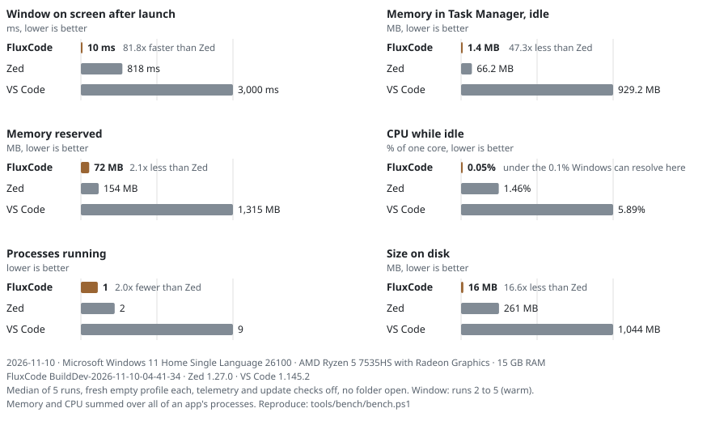

<!-- Made from README.flux by FluxCode (fluxcode --flux-to-md README.flux README.id.md). Edit README.flux, not this file. -->

# FluxCode

[English](README.md) · **Bahasa Indonesia** · [Roadmap (2026-2027)](ROADMAP.md) · [Diskusi](https://github.com/MuaraAI/FluxCode/discussions)

FluxCode adalah editor kode native yang dirender GPU untuk Windows, macOS, dan Linux,
ditulis dalam Rust. Dikemas sebagai satu binary 16 MB dengan workspace agent AI terintegrasi,
terminal yang ramah Python, Git bawaan, dan tampilan baca-saja instan untuk file binary,
arsip, database, maupun Office. Jendelanya terbuka dalam ~50 ms, hanya memakai 1,4 MB RAM
saat idle dalam satu proses ([benchmark](#benchmark)), dan tanpa telemetri sama sekali.

Dibangun di [MuaraAI](https://github.com/MuaraAI) oleh tim engineer berpengalaman di
sistem Rust yang telah membangun dan menjalankan produk SaaS produksi sejak 6 tahun lalu
hingga sekarang. Open source di bawah lisensi GPL-3.0-or-later dan terus dikembangkan
secara aktif lewat rilis berkelanjutan dari `main` serta [Roadmap 2026-2027](ROADMAP.md)
(pengamanan inti, LSP ringan, hingga rilis native Android di 2027).

[](https://github.com/MuaraAI/FluxCode/releases/latest)
[](https://github.com/MuaraAI/FluxCode/commits/main)
[](https://github.com/MuaraAI/FluxCode/actions/workflows/build.yml)
[](LICENSE)

<a href="assets/screenshots/agent-workspace.png"></a>

Workspace layar penuh milik agent: daftar chat di kiri, percakapan aktif di tengah, dan
diff file secara langsung di kanan, melayang di atas latar yang digambar GPU. Saat fokus
menulis kode, tekan `Ctrl+L` untuk menaruh agent sebagai panel ringkas di samping.

## Benchmark

Di laptop Windows 11 standar, FluxCode menampilkan jendela pertamanya dalam **~50 ms** dan
turun ke **1,4 MB** di Task Manager saat idle, semuanya dalam satu proses. Di mesin yang
sama, Zed butuh 818 ms dan 66,2 MB; VS Code butuh ~3 detik dan 929,2 MB di sembilan proses.

<picture>
  <source media="(prefers-color-scheme: dark)" srcset="assets/benchmarks/benchmark-dark.svg">
  
</picture>

Perbedaannya paling terasa saat editor dibiarkan terbuka seharian sambil kamu berpikir,
membaca dokumentasi, atau menjalankan build: FluxCode hanya memakai 1,4 MB RAM saat idle
(dibanding 66,2 MB di Zed dan 929,2 MB di VS Code) dan hanya memakan 16 MB di disk. Makin
kecil angkanya, makin baik.

*Median dari 5 pengukuran di PC dengan AMD Ryzen 5 7535HS dan 15 GB RAM, 10 November 2026.
Semua aplikasi dijalankan dari profil baru yang kosong, dengan telemetri dan pemeriksaan
update dimatikan serta tanpa folder terbuka.*

<details><summary>Angka lengkap, metodenya, dan apa yang tidak diukur di sini</summary>

Median, dengan nilai terendah dan tertinggi tiap pengukuran di dalam tanda kurung:

| | FluxCode BuildDev-2026-11-10-04-41-34 | Zed 1.27.0 | VS Code 1.145.2 |
| --- | --- | --- | --- |
| Jendela tampil setelah diluncurkan (ms) | sekitar 50, diukur manual (bench.ps1: 221) | 818 (387 sampai 1.322) | 3.000 |
| Memori di Task Manager, idle (MB) | 1,4 (1,0 sampai 4,8) | 66,2 (65,2 sampai 71,9) | 929,2 (867,7 sampai 985,4) |
| Memori yang direservasi (MB) | 72 (72 sampai 72) | 154 (153 sampai 156) | 1.315 (1.249 sampai 1.399) |
| CPU saat idle (% satu core) | 0,05 (0,00 sampai 0,68) | 1,46 (1,15 sampai 2,60) | 5,89 (5,57 sampai 8,12) |
| Proses berjalan | 1 | 2 | 9 |
| Ukuran di disk (MB) | 16 | 261 | 1.044 |

- **Jendela**: dari diluncurkan sampai jendela pertama terlihat, pengukuran ke-2 sampai
  ke-5 (pengukuran pertama membaca program dari disk dalam keadaan dingin). Angka VS Code
  adalah waktu sampai workbench siap dipakai, sekitar 3 detik: jendelanya tampil sebelum
  workbench di dalamnya selesai dimuat.
- **Waktu jendela FluxCode** sekitar 50 ms, diukur manual oleh pengelola proyek.
  `bench.ps1` mencatat 221 ms untuknya, tetapi loop PowerShell-nya memanggil `Get-Process`
  di setiap polling, jadi angka itu ikut memuat waktu skrip sendiri. Angka Zed dan VS Code
  berasal dari skrip yang sama.
- **Memori di Task Manager**: private working set, 9 detik setelah diluncurkan, dijumlahkan
  dari semua proses aplikasi. FluxCode mengembalikan memori yang tidak dipakai ke Windows
  6 detik setelah start, jadi angka ini adalah kondisi idle-nya; sekitar 5 MB setelah satu
  klik dan sekitar 30 MB saat animasi pemasangan agent berjalan. Zed dan VS Code menyimpan
  memorinya.
- **Memori yang direservasi**: private bytes (commit), memori yang sudah diklaim aplikasi
  entah sedang berada di RAM atau tidak.
- **CPU saat idle**: waktu CPU dari detik ke-9 sampai ke-39 setelah diluncurkan, sebagai
  bagian dari satu core. Windows menghitungnya dalam langkah 15,6 ms, jadi 0,05% milik
  FluxCode sudah di batas kemampuan pengukuran untuk membedakannya dari nol.
- **Ukuran di disk**: folder pemasangan; untuk FluxCode, satu file programnya.
- **Yang tidak diukur di sini**: latensi mengetik, membuka file sangat besar, bekerja di
  proyek besar, atau apa pun dengan extension dan language server termuat. Zed dan VS Code
  lebih jauh di area itu (lihat tabel perbandingan di bawah: FluxCode belum punya debugger,
  extension, maupun language server).
- **Cara mengulang**: tutup ketiga aplikasi, lalu jalankan
  `powershell -ExecutionPolicy Bypass -File tools/bench/bench.ps1 -FluxExe <path ke fluxcode.exe>`
  dan `python tools/bench/chart.py`. Data mentahnya ada di
  [`tools/bench/results.json`](tools/bench/results.json).

</details>

## Unduh

Ambil build terbaru dari [Releases](https://github.com/MuaraAI/FluxCode/releases/latest).

| Sistem | File | Pemasangan |
| --- | --- | --- |
| Windows 10/11, x64 | `FluxCode-BuildDev-...-windows-x64-setup.exe` | Jalankan installer. Tanpa hak admin: terpasang di akunmu lengkap dengan pintasan Start Menu dan Desktop. |
| macOS 11+, Apple Silicon dan Intel (preview) | `FluxCode-BuildDev-...-macos-universal.dmg` | Buka DMG lalu tarik FluxCode ke Applications. |
| Linux, x64 (glibc 2.35+, Vulkan) | `FluxCode-BuildDev-...-linux-x64.tar.gz` | Ekstrak lalu jalankan `./install.sh` (tanpa root). |
| Windows, portable | `FluxCode-BuildDev-...-windows-x64.zip` | Ekstrak di mana saja dan jalankan `FluxCode.exe` langsung (`Install.cmd` juga tersedia bila ingin dipasang). |

Build macOS saat ini masih berstatus preview dan belum dinotarisasi Apple, jadi macOS akan
meminta konfirmasi sekali saat pertama dibuka (di macOS 15+, buka aplikasinya lalu pilih
**System Settings > Privacy & Security > Open Anyway**; di versi lama, klik kanan
FluxCode > **Open**). Kalau menemukan kendala di Mac, silakan
[buka issue](https://github.com/MuaraAI/FluxCode/issues/new).

Kami merilis build `BuildDev-YYYY-MM-DD-HH-MM-SS` secara berkelanjutan setiap ada perubahan
yang masuk ke `main`. Aplikasi yang sudah terpasang akan menampilkan kartu notifikasi saat
build baru tersedia dan bisa diperbarui dalam satu klik (bisa dimatikan kapan saja lewat
**Settings > Updates**).

## Lebih dekat

<table>
  <tr>
    <td width="50%" valign="top">
      <a href="assets/screenshots/token-saver.png"></a>
      <br><sub><b>Hemat token</b></sub>
    </td>
    <td width="50%" valign="top">
      <a href="assets/screenshots/usage-limit.png"></a>
      <br><sub><b>Saat limit pemakaian tercapai</b></sub>
    </td>
  </tr>
</table>

**Hemat token** (ikon daun di bawah kotak pesan) memangkas jawaban agent yang bertele-tele,
mengutamakan diff dibanding menulis ulang seluruh file, dan menjaga pemakaian tool tetap
efisien. Saat kuota atau rate limit tercapai, FluxCode membaca jadwal reset-nya sehingga
kamu bisa klik **Continue now** atau centang **Resume at reset** agar pekerjaan dilanjutkan
otomatis begitu kuota kembali.

<table>
  <tr>
    <td width="50%" valign="top">
      <a href="assets/screenshots/side-bars-search.png"></a>
      <br><sub><b>Search di side bar mana pun</b></sub>
    </td>
    <td width="50%" valign="top">
      <a href="assets/screenshots/extensions-marketplace.png"></a>
      <br><sub><b>Seluruh VS Code Marketplace</b></sub>
    </td>
  </tr>
</table>

Klik kanan ikon mana pun di activity bar untuk menaruh panelnya di kiri atau di kanan.
Pencarian proyek menampilkan hasil secara instan saat kamu mengetik, dan panel Extensions
terhubung langsung ke seluruh katalog VS Code Marketplace.

<a href="assets/screenshots/backgrounds.png"></a>

<table>
  <tr>
    <td width="50%" valign="top">
      <a href="assets/screenshots/settings-backgrounds.png"></a>
      <br><sub><b>Dua belas latar, dengan pratinjau langsung</b></sub>
    </td>
    <td width="50%" valign="top">
      <a href="assets/screenshots/backgrounds-themes.png"></a>
      <br><sub><b>Satu scene dalam empat tema</b></sub>
    </td>
  </tr>
</table>

Dua belas latar prosedural (awan, laut, pegunungan, aurora, hutan, danau, pantai, bukit
pasir, kota, hujan, salju, galaksi) digambar langsung menggunakan palet warna tema aktifmu
tanpa perlu mengunduh aset tambahan. Secara default latar ini diam (0% CPU); saat
**Background animation** dinyalakan, FluxCode mengukur beban CPU di mesinmu terlebih dulu
dan memberi tahu apakah animasinya ringan atau berat untuk perangkatmu.

## Yang membedakannya

- **Familiar seperti VS Code.** Tata letak (activity bar, side bar, tab, panel bawah, status
  bar) dan shortcut utamanya (`Ctrl+Shift+P`, `Ctrl+P`, `Ctrl+G`, `Ctrl+/`, `Alt+Up/Down`)
  sama persis dengan yang biasa kamu pakai di VS Code. Bedanya, tidak ada runtime Electron
  atau Node di dalam editor: tema warna dan grammar VS Code dimuat secara native di Rust
  tanpa mengeksekusi JavaScript berat.
- **Efisiensi tingkat sistem.** Ditulis dalam Rust di atas GPUI dengan optimasi D3D11
  swap-chain, tekstur on-demand, dan syntax highlighting inkremental per baris. Dalam
  [benchmark](#benchmark), jendela terbuka dalam ~50 ms, mereservasi 72 MB, dan memangkas
  pemakaian RAM idle hingga 1,4 MB.
- **Alur kerja AI agent kelas satu (ACP).** Mendukung Agent Client Protocol secara penuh
  untuk seluruh agent di registri ACP (OpenCode, Claude Code, Codex, Gemini CLI, Copilot,
  Cursor, Qwen, Command Code, dan lainnya). Pasang agent dalam satu klik, atur model dan
  level effort langsung di bawah kotak chat, tinjau diff per giliran, atau batalkan perubahan
  file kapan saja.
- **Inline completion GitHub Copilot.** Terhubung ke `@github/copilot-language-server`
  resmi di proses terpisah agar editor utama tetap ringan. Cukup pasang dengan
  `npm install -g @github/copilot-language-server` lalu masuk lewat
  **Settings > AI agents and GitHub**.
- **Dirancang oleh engineer Rust & SaaS berpengalaman.** Dibuat oleh developer yang sudah
  menangani pemrograman sistem Rust dan membangun produk SaaS sejak 6+ tahun lalu hingga
  sekarang: ramah bagi pemula lewat setup satu klik dan mode aman baca-saja, sekaligus
  lengkap bagi engineer senior dengan kustomisasi penuh.

## Extension dan FluxCompile

Tampilan Extensions (`Ctrl+Shift+X`) adalah VS Code Marketplace: seluruhnya, dimuat per
halaman sambil kamu menggulir, dicari sambil kamu mengetik (pencarian sebelumnya kembali
seketika), diurutkan menurut relevansi, jumlah pasang, rating, update terakhir, atau nama,
dan disaring per kategori. Install menaruh VSIX extension itu di
`~/.fluxcode/vscode-extensions`; Update dan Uninstall ada di halamannya, dan tombol folder
memasang file `.vsix` lokal. Extension host JavaScript milik VS Code bukan bagian dari
FluxCode, jadi kode extension itu sendiri tidak berjalan di sini; halamannya menyebutkan apa
yang dideklarasikannya (tema, bahasa, snippet).

Dukungan proyek milik FluxCode sendiri selalu aktif, tanpa perlu dipasang: plugin Paper,
add-on Bedrock, Gradle, Maven, Node.js, Rust, Python, Go, C/C++ (CMake dan Make), .NET, dan
pratinjau HTML. Masing-masing satu manifest JSON kecil: file yang menandai proyeknya, task
yang ditambahkannya, alat yang dibutuhkannya (dengan id winget untuk memasangnya), dan
catatan untuk agent AI. Tampilan Run mendaftar proyek di folder itu beserta task-nya, dan
agent diberi tahu proyek itu apa serta bagaimana ia dibangun.

- **Plugin Paper (Minecraft Java).** Build, Build & deploy, Start server, Test, Clean. Nama
  proyeknya adalah nama plugin-nya, dibaca dari `plugin.yml` di dalam jar hasil build.
  Deploy menyalin jar ke folder `plugins` server uji sebagai `<Nama>-<versi>.jar` dan
  membuang build lama plugin yang sama (dikenali dari nama di dalam tiap jar). Servernya
  adalah folder di atas plugin yang punya folder `plugins` dan `paper-*.jar`. Plugin baru
  menulis proyek Gradle untuk versi server itu, lengkap dengan Gradle wrapper.
- **Add-on Bedrock.** Check manifest (UUID, versi, tipe modul, entri script, dependensi
  antar pack), Deploy to Minecraft (ke folder development pack milik gamenya), dan Pack
  `.mcaddon` yang di-zip sendiri oleh FluxCode. Add-on baru menulis behavior pack dan
  resource pack yang saling bergantung.
- **FluxCompile** adalah cara FluxCode menjalankan build Java. Ia memakai JDK yang diminta
  proyek (toolchain Gradle atau `release` Maven, dicari di folder pemasangan biasa atau
  folder `tools/jdk-*` di sebelah proyek), build cache lokal Gradle kecuali proyeknya
  mematikannya, serta pengaturan proyek sendiri untuk build paralel dan configuration
  cache. Baris task Gradle dilipat jadi satu baris progres dan ditutup dengan apa yang
  berhasil dibangun. Error kompilasi membuka file di barisnya. Memaksa configuration cache
  atau build paralel dari luar bisa merusak build, jadi FluxCompile tidak melakukannya;
  kami memeriksa bagaimana 28 plugin besar (LuckPerms, EssentialsX, WorldEdit, Geyser,
  ViaVersion, dan lainnya) dibangun sebelum memutuskan.
- Diukur pada plugin Paper multi-modul (55 task Gradle, jar 609 KB): build pertama 14,6
  detik (40 task jalan, 15 dari cache), build tanpa perubahan 1,9 detik dengan daemon
  Gradle sudah panas.

## Dokumen Flux

README ini ditulis dalam Flux (`README.flux`); `README.md` yang tampil di GitHub dibuat
dari situ. File `.flux` adalah teks Markdown ditambah blok satu baris untuk hal yang
biasanya diserahkan Markdown ke HTML: lebar gambar dan versi tema gelap, gambar
berdampingan, video, flowchart, callout, bagian yang bisa dilipat, kolom, daftar isi, dan
bagian per bahasa. FluxCode membukanya dalam bentuk tergambar, dengan Preview dan Source
di atasnya.

- **Ringan di ukuran apa pun**: satu kali pembacaan teks, tanpa salinan, hanya baris yang
  terlihat yang digambar, dan teks dokumen besar disimpan dalam bentuk padat. Dokumen
  1,3 juta baris (31,8 MB, berisi tabel 200.000 baris) menampilkan layar pertamanya setelah
  0,08 ms pembacaan, terbuka dalam 0,3 detik, dan menampilkan 16 MB di Task Manager
  (teksnya disimpan dalam 2,3 MB).
- **Terbaca di GitHub**: `fluxcode --flux-to-md README.flux README.md` (atau **Save as
  Markdown** di FluxCode) menulis Markdown untuk GitHub; flowchart jadi Mermaid dan
  callout jadi alert milik GitHub. Tambahkan `--lang id` untuk bagian Indonesianya, yang
  tersedia sebagai `README.id.md`. Test gagal kalau file-file itu tidak sama.

> [!TIP]
> **Seluruh sintaksnya**
> [docs/flux.id.md](docs/flux.id.md) menjelaskan semua blok, ditulis dalam Flux itu sendiri
> ([docs/flux.flux](docs/flux.flux)).

## Kemampuan lainnya

- Pewarnaan sintaks untuk sekitar 200 bahasa, dipilih dari nama file, ekstensi, atau baris
  `#!`.
- Workspace multi-root: tarik folder ke jendela untuk menambahkannya atau berpindah ke
  situ.
- Panel agent (`Ctrl+L`) menjalankan agent apa pun di [registri ACP](https://agentclientprotocol.com),
  seperti OpenCode 2, Claude Agent, Codex, Gemini CLI, atau GitHub Copilot. Agent yang belum ada di PC-mu punya tombol unduh di menu agent (lengkap dengan
  ikonnya sendiri dari registri); FluxCode menaruhnya di `~/.fluxcode/agents` (termasuk
  paket npm, tidak ke npm global-mu) dan hanya menjalankannya selama panel dipakai. Model,
  effort, mode, dan izin berupa tombol di bawah kotak pesan; masing-masing membuka daftar
  tepat di atasnya dengan kotak pencarian, dan menu agent menunjukkan agent mana yang
  aktif. GitHub Copilot, yang tidak menawarkan model lewat ACP, mengambil daftar modelnya
  langsung dari Copilot dan restart dengan model pilihanmu, di chat yang sama. Sunting
  pesan yang sudah terkirim dan jawabannya dimulai ulang dari situ; agent mendapat
  ringkasan workspace. Memori adalah milik agent itu sendiri (FluxCode tidak menambahkan
  memorinya sendiri).
- **Effort dan model, beserta harganya.** Effort berupa slider (low sampai max) yang mulai
  di medium: tarik, atau klik satu tingkat. Tiap model menunjukkan berapa token yang
  dibacanya sekaligus dan ditulisnya dalam satu jawaban, dan model gratis ditandai Free
  (dari daftar model yang disimpan OpenCode di PC-mu). Model Claude Agent dikelompokkan per
  generasi, terbaru lebih dulu, masing-masing dengan harga per juta token, karena yang
  lebih baru mengerjakan pekerjaan sama dengan token lebih sedikit.
- **Penggunaan tanpa mengetik `/usage`.** Meter di bawah kotak pesan menunjukkan seberapa
  penuh konteksnya; meter itu, tombol gauge, atau mengetik `/usage` membuka panel berisi
  batas paket (yang 5 jam dan mingguan), kapan masing-masing direset, context window, biaya
  sesi, dan apa yang paling banyak memakai batas, semuanya dibaca dari agent itu sendiri.
  Batasnya direset sendiri; Request usage credits bertanya dulu, lalu meminta tambahan ke
  paket dan menampilkan jawabannya.
- **Pencarian web yang bisa diikuti.** Saat agent mencari di web atau membaca halaman,
  chat menampilkan kueri dan sumbernya, masing-masing berjarak satu klik.
- **Apa yang sedang dilakukan agent, saat melakukannya.** Thinking, reading, editing,
  menjalankan perintah, dan searching adalah langkah-langkah dalam satu baris: langkah yang
  berjalan punya garis tipis bergerak di bawahnya, dan saat selesai labelnya berubah dari
  "Reading" menjadi "Read" beserta lamanya.
- **Browser untuk setiap agent.** FluxCode memberi tiap sesi agent sebuah browser yang
  bisa dikendalikannya: Chrome, Brave, atau Edge yang sudah ada di PC-mu (Chrome kalau
  tersedia), lewat [chrome-devtools-mcp](https://github.com/ChromeDevTools/chrome-devtools-mcp)
  dari Google melalui Chrome DevTools Protocol. Agent membuka halaman, mengklik dan
  mengetik, membaca console dan permintaan jaringan, mengambil screenshot dan snapshot
  aksesibilitas, serta merekam trace performa. Tidak ada yang diunduh selain alat 15 MB
  itu, dipasang sekali ke `~/.fluxcode/tools/browser`; browsernya memakai profil sendiri,
  tidak pernah cookie atau password-mu, dan statistik penggunaan Google dimatikan. Agent
  settings > Browser memilih browsernya, berupa jendela atau tanpa jendela, atau
  mematikannya.
- Source Control melakukan commit, push, pull, dan sync, menampilkan graf commit, membuka
  pull request dan GitHub Actions lewat `gh`, serta Remove Git untuk membatalkan `git init`.
- Source Control memberi tahu kalau remote punya commit yang belum kamu miliki. Ia
  menjalankan `git fetch` senyap tiap lima menit (dan saat kamu kembali ke jendela), tanpa
  pernah meminta password, dan bagian Incoming di atas mendaftar commit baru: judul dan
  penulisnya, lalu file yang diubah tiap commit, dan diff sebuah file di panel Output.
  Pull menariknya masuk, atau sisihkan sampai ada yang lain datang. Titik biru di ikon
  Source Control menandakan ada yang baru.
- Setelah update, halaman "What's new" terbuka sekali berisi catatan sejak build terakhir
  (dari [`changelog.flux`](changelog.flux), dalam bahasa antarmuka). Help > What's New
  membukanya lagi.
- OpenCode 2 adalah build native OpenCode dari opencode.ai di registri, yang dipasang
  FluxCode dan diperiksa terhadap SHA-256-nya. OpenCode 2 yang sudah kamu pasang (lewat npm
  `@opencode/cli`, atau installer opencode.ai) langsung dipakai; OpenCode 1 tidak. Pilihan
  OpenCode yang sudah ada berpindah ke OpenCode 2 beserta pengaturannya.
- Agent yang sudah ada di PC kamu ditemukan seperti Windows menemukan program: dari PATH
  Windows saat itu dan dari folder yang dipakai installer (npm, pnpm, bun, Scoop, WinGet,
  `~/.local/bin`), jadi tidak ada yang diunduh dua kali.
- Nama tema warna di status bar membuka tujuh tema, masing-masing digambar sebagai editor
  kecil dalam warnanya sendiri.
- File Markdown menggambar dirinya sendiri: README terbuka sebagai teks, dan ikon mata di
  atasnya mengubahnya menjadi halaman tergambar seperti di GitHub (judul, tabel, daftar,
  gambar lokal, callout `> [!NOTE]` milik GitHub), dengan Source untuk kembali. Dokumen
  Flux tetap punya Preview dan Source sendiri.
- Settings > About FluxCode menautkan ke repositori ini, issue tracker, dan changelog.
- **Side bar di kedua sisi.** Explorer, Search, Source Control, Run, Extensions, dan agent
  masing-masing bisa ditaruh di side bar kiri atau kanan, seperti secondary side bar VS
  Code: klik kanan ikon di activity bar untuk memindahkannya. Header side bar kanan
  berpindah di antara view yang ada di sana.
- **Find in files sambil mengetik.** Hasil diperbarui setelah jeda singkat saat mengetik,
  tiap kecocokan diberi warna, dan file dengan banyak kecocokan dilipat ke enam baris
  pertamanya dengan baris "N hasil lagi". Di repositori git, hanya file yang dilacak git
  atau tidak diabaikan yang dibaca, dengan beberapa thread.
- **Workspace layar penuh untuk agent.** Tombol layar penuh di header agent mengubahnya
  menjadi tiga kolom: daftar chat, percakapan, dan file yang diubahnya beserta diff dan
  undo. Kolom-kolomnya menyingkir di jendela yang sempit.
- **Hemat token.** Caveman (Lite, Full, atau Ultra) meminta jawaban lebih pendek, Lean code
  meminta diff alih-alih seluruh file, Quiet tools meminta membaca dan mencetak seperlunya.
  Panduannya ikut terkirim bersama pesan saat paketnya berubah dan tiap beberapa giliran,
  jadi panduan itu sendiri hampir tidak memakan token.
- **Limit pemakaian tercapai.** Banner di atas kotak pesan menunjukkan kapan limit reset.
  Continue now mengirim ulang pesan yang terpotong; Resume at reset melakukannya sendiri
  setelah jendela limitnya reset.
- **Penggunaan Disk (WizTree) untuk agent AI.** Penganalisis pohon disk dan treemap
  bawaan berbasis Rust yang menyuplai ringkasan struktur folder (terbesar, terkecil, titik
  boros, ekstensi, dan file terbesar) langsung ke agent lewat `@wiztree`, **Tanya Agent**,
  atau `fluxcode --wiztree`, sehingga agent paham kondisi penyimpanan tanpa memindai manual.
- **Data Minecraft Bedrock.** Buka dan edit file biner `level.dat`, `level.dat_old`,
  `.mcstructure`, dan `.nbt` sebagai SNBT bersih dengan penyimpanan biner lossless, plus
  inspeksi baca-saja untuk LevelDB `db/*.log` dan `db/*.ldb`.
- **Terminal multibahasa.** Membaca error dan stack trace lintas Python, JavaScript,
  TypeScript, Rust, Go, Java, Kotlin, C/C++, C#, Zig, PHP, Ruby, Lua, Dart, Swift, Shell,
  dan PowerShell dengan klik langsung ke file:baris:kolom dan cycling Tab inline.
- **Liquid glass dan latar beranimasi.** Panel bisa menjadi tembus pandang di atas blur
  sistem, dengan kartu kaca yang melayang. Dua belas latar beranimasi bergerak di
  belakangnya, digambar langsung dengan warna tema (tanpa video dan tanpa unduhan). Secara
  default scene-nya diam; Background animation membuatnya bergerak 24 frame per detik saat
  jendela di depan (sekitar 10 sampai 15% dari satu core CPU) dan beberapa frame saat di
  belakang jendela lain, dan saat dinyalakan FluxCode lebih dulu mengukur apakah PC kamu
  sanggup.

## FluxCode, Zed, dan VS Code

Ketiganya editor bagus yang dibuat untuk orang berbeda. Berikut posisi masing-masing hari
ini.

FluxCode adalah yang paling ringan dari ketiganya dengan selisih yang besar, dan selisih
itu makin terasa makin lama editor dibiarkan terbuka. Ia memakai 1,4 MB saat idle lawan
66,2 MB untuk Zed dan 929,2 MB untuk VS Code, dan memakan 16 MB di disk lawan 261 MB dan
1.044 MB. Ia terbuka dalam sekitar 50 ms, lawan 818 ms dan sekitar 3 detik. Yang ia korbankan
terlihat jelas di tabel: belum ada debugger maupun language server, dan extension VS Code
bisa dipasang tetapi kodenya tidak berjalan.

| | FluxCode | Zed | VS Code |
| --- | --- | --- | --- |
| Dibangun dengan | Rust, GPUI (digambar GPU) | Rust, GPUI (digambar GPU) | TypeScript di Electron (Chromium + Node.js) |
| Sistem | Windows, macOS, Linux | macOS, Linux, Windows | Windows, macOS, Linux, web |
| Yang diunduh | satu program, sekitar 16 MB | sebuah installer | sebuah installer |
| Tata letak dan tombol | tata letak VS Code dan tombol VS Code untuk perintah yang ada | tata letaknya sendiri; tersedia key map VS Code | yang aslinya |
| Start, memori, CPU, ukuran | sekitar 50 ms, 1,4 MB idle, 1 proses, 16 MB ([benchmark](#benchmark)) | 0,82 detik, 66 MB, 2 proses, 261 MB | sekitar 3 detik, 929 MB, 9 proses, 1 GB |
| Telemetri | tidak ada | aktif secara bawaan, bisa dimatikan | aktif secara bawaan di build Microsoft, bisa dimatikan |
| Kecerdasan bahasa (go to definition, rename, diagnostik) | belum ada: warna dan penyelesaian kata | bawaan, lewat language server | lewat extension |
| Debugger | belum ada (hanya Run) | ada | ada |
| Extension | VS Code Marketplace untuk dijelajah dan dipasang (kodenya tidak berjalan), plus 11 manifest proyek bawaan | ada | katalog terbesar |
| Agent AI | agent ACP apa pun, tiga tingkat akses, perubahan per giliran dengan undo | agent sendiri dan agent ACP | GitHub Copilot dan extension |
| File yang bukan teks | hex, PDF, Office, ZIP, SQLite, LevelDB (baca-saja); NBT Bedrock/Java (bisa diedit) | gambar | gambar; lebih banyak lewat extension |
| Pengembangan jarak jauh | WSL2 (Windows) | SSH | SSH, container, WSL |
| Bahasa antarmuka | Inggris, Bahasa Indonesia | Inggris | banyak, lewat language pack |
| Kematangan | build pengembangan | rilis stabil | stabil, dipakai luas |
| Lisensi | GPL-3.0-or-later | GPL-3.0 (editornya) | MIT untuk Code - OSS; build Microsoft punya lisensi sendiri |

Pilih FluxCode kalau kamu ingin editor kecil dan tenang di Windows, macOS, atau Linux
dengan agent yang bisa dijaga ketat, kodemu bisa tinggal di distro WSL2, dan kamu membuka
log, database, serta dokumen di samping kode.
Pilih Zed untuk language server yang langsung jalan dan pair programming.
Pilih VS Code kalau kamu butuh extension tertentu, debugger, atau pengembangan jarak jauh
selain WSL.

## Editor lain sekilas

Editor-editor ini tidak ikut dalam benchmark, jadi tabel ini tidak berisi angka ukur
untuk mereka. Tabel ini hanya membandingkan apa yang didokumentasikan masing-masing
proyek: dibuat dengan apa, berjalan di mana, dan apa yang sudah terpasang bawaan.

| Editor | Dibangun dengan | Sistem | Language server | Debugger | Extension | Agent AI |
| --- | --- | --- | --- | --- | --- | --- |
| Sublime Text | C++ | Windows, macOS, Linux | lewat paket LSP, bukan bawaan | tidak ada bawaan | plugin Python, lewat Package Control | tidak ada bawaan |
| Notepad++ | C++ (Win32, Scintilla) | Windows saja | lewat plugin, bukan bawaan | tidak ada bawaan | plugin, lewat Plugin Admin | tidak ada bawaan |
| Lapce | Rust | Windows, macOS, Linux | bawaan | tidak ada bawaan | plugin WASI | tidak ada bawaan |
| Helix | Rust | terminal, di Windows, macOS, dan Linux | bawaan | bawaan, lewat DAP (eksperimental) | belum ada | tidak ada bawaan |
| Neovim | C, dengan Lua | terminal, di Windows, macOS, dan Linux | bawaan | lewat plugin, bukan bawaan | plugin Lua, ekosistem besar | tidak ada bawaan, lewat plugin |

FluxCode paling dekat dengan Lapce dan Helix secara semangat: editor Rust kecil yang
tidak menghalangi. Yang membedakannya dari mereka adalah antarmuka grafis, tata letak
dan tombol VS Code, serta panel agent. Kelima editor di atas tidak diukur dalam
benchmark, jadi jangan baca tabel ini sebagai peringkat kecepatan.

## Privasi

FluxCode tidak mengirim apa pun tentangmu. Satu-satunya permintaan yang dibuat sendiri
adalah pemeriksaan update: `GET` biasa ke daftar rilis di github.com, tanpa build ID,
machine ID, atau cookie, saat start dan tiap 6 jam (Settings > Updates mematikannya).
Sisanya keluar hanya saat kamu memulainya: agent yang kamu jalankan, `git`, GitHub saat
kamu masuk, dan `changelog.flux` build baru saat kamu menekan What's new di kartu update.
Menu agent membaca daftar agent ACP publik dari cdn.agentclientprotocol.com, paling banyak
sekali sehari dan hanya saat menu itu dibuka.
Saat agent pertama kali dijalankan, FluxCode memasang alat browser untuk agent
(chrome-devtools-mcp) dari registri npm; Agent settings > Browser > Off melewatinya.
Extension tidak mengunduh apa pun sendiri: Add Gradle wrapper menanyakan versi terbaru ke
services.gradle.org dan mengambil wrapper dari repositori GitHub Gradle, dan tombol Install
di halaman sebuah extension menjalankan `winget` di Terminal, hanya saat kamu menekannya.
Tampilan Extensions meminta daftar ke marketplace.visualstudio.com selama tampilan itu
terbuka, dan mengunduh VSIX sebuah extension hanya saat kamu menekan Install.

## Pintasan

Tombol VS Code di Windows, macOS, dan Linux. `Ctrl+Shift+P` (atau `F1`) mendaftar semua
perintah beserta tombolnya, dan Settings > Keyboard shortcuts menampilkan daftar yang sama.

| Aksi | Tombol |
| --- | --- |
| Command Palette | `Ctrl+Shift+P` / `F1` |
| Go to File / Go to Line | `Ctrl+P` / `Ctrl+G` |
| Find / Replace / Find in Files | `Ctrl+F` / `Ctrl+H` / `Ctrl+Shift+F` |
| Open File / Open Folder | `Ctrl+O` / `Ctrl+K Ctrl+O` |
| Save / Save All | `Ctrl+S` / `Ctrl+K S` |
| Tutup tab / Tutup semua / Buka yang ditutup | `Ctrl+W` / `Ctrl+K Ctrl+W` / `Ctrl+Shift+T` |
| Tab berikutnya / sebelumnya | `Ctrl+Tab` atau `Ctrl+PageDown` / `Ctrl+Shift+Tab` atau `Ctrl+PageUp` |
| Komentar baris | `Ctrl+/` |
| Pindah baris ke atas / ke bawah | `Alt+Up` / `Alt+Down` |
| Salin baris ke atas / ke bawah | `Shift+Alt+Up` / `Shift+Alt+Down` |
| Tambah kursor di atas / di bawah | `Ctrl+Alt+Up` / `Ctrl+Alt+Down` |
| Hapus baris | `Ctrl+Shift+K` |
| Baris baru di bawah / di atas | `Ctrl+Enter` / `Ctrl+Shift+Enter` |
| Indent / outdent | `Ctrl+]` / `Ctrl+[` |
| Word wrap | `Alt+Z` |
| Font editor lebih besar / kecil / reset | `Ctrl+=` / `Ctrl+-` / `Ctrl+0` |
| Side bar / Panel / Terminal | `Ctrl+B` / `Ctrl+J` / ``Ctrl+` `` |
| Explorer / Source Control / Run / Extensions | `Ctrl+Shift+E` / `Ctrl+Shift+G` / `Ctrl+Shift+D` / `Ctrl+Shift+X` |
| Jalankan file / Stop | `F5` / `Shift+F5` |
| Panel agent | `Ctrl+L` |
| Settings / Tema berikutnya | `Ctrl+,` / `Ctrl+K Ctrl+T` |

`Ctrl+L` membuka agent (seperti di Cursor) di tempat VS Code memilih satu baris.

## Build dari sumber

Rust stable, lalu:

```sh
cargo build --release          # target/release/fluxcode(.exe)
cargo test --bin fluxcode
```

- Windows: shader HLSL butuh `fxc.exe` dari Windows SDK, atau setel `GPUI_FXC_PATH` ke
  `tools/fxc-shim` yang dibangun dengan
  `cargo build --release --manifest-path tools/fxc-shim/Cargo.toml`. Dengan toolchain GNU,
  pakai `CARGO_TARGET_DIR` tanpa spasi (`windres` MinGW). `packaging/windows/build.ps1
  -Install` membangun, mengemas, dan memasang seperti rilis.
- Linux: `pkg-config clang libxkbcommon-dev libxkbcommon-x11-dev libwayland-dev
  libx11-xcb-dev libxcb1-dev libfontconfig1-dev libfreetype6-dev libvulkan-dev` (nama paket
  Debian dan Ubuntu).
- macOS: Xcode (untuk shader Metal). `packaging/macos/bundle.sh BUILD BINARY OUT` mengemas
  sebuah binary jadi `FluxCode.app`, `.dmg`, dan arsip update, seperti rilis.
- Build menamai dirinya dari `FLUXCODE_BUILD` (`BuildDev-YYYY-MM-DD-HH-MM-SS`); tanpa itu,
  dari waktu UTC saat itu.

## Berkontribusi

FluxCode open source, dan issue terbuka untuk siapa saja: laporkan bug atau usulkan ide
lewat [Issues](https://github.com/MuaraAI/FluxCode/issues/new/choose). Bot memeriksa tiap
issue baru terhadap laporan lama dengan masalah yang sama dan terhadap build yang sudah
usang.

Pull request terbuka untuk siapa saja. Fork repositori ini, buat branch dari `main`, lalu
buka pull request; untuk fitur baru atau dependency baru, buka issue dulu supaya idenya
disepakati sebelum kodenya ditulis.

Tiap pull request diperiksa otomatis, dan tiap push diperiksa ulang:

| Pemeriksaan | Yang dilihat | Gagal kalau |
| --- | --- | --- |
| **Safety scan** | Tiap baris dan file yang ditambahkan, cuma dibaca tanpa dijalankan: pola malware (unduh-lalu-jalankan, reverse shell, miner, pencurian kredensial, injeksi proses), token dan kunci yang bocor, karakter tak terlihat atau kanan-ke-kiri, blob ter-encode, file executable, dependency dari luar crates.io | Ada yang berbahaya atau rahasia, atau orang di luar tim mengubah file CI, build, atau packaging |
| **Performa** | Pull request dan `main`, dibangun dengan cara yang sama di runner yang sama dan dijalankan 40 kali masing-masing: ukuran executable, waktu start, waktu konversi Markdown, memori puncak, jumlah crate | Ukuran naik lebih dari 10%, sebuah run lebih lambat lebih dari 25%, atau memori naik lebih dari 40% (perubahan lebih kecil ditandai sebagai peringatan) |
| **Kualitas kode** | Hanya baris yang ditambahkan pull request: clippy, rustfmt, `unwrap()`, `dbg!`, `thread::sleep`, baris dan file yang terlalu panjang | Ada lint clippy `correctness`, `suspicious`, atau `perf`, error kompilasi, atau `dbg!` yang tertinggal |
| **Dependency** | Database advisory RustSec, lewat cargo-deny | Sebuah dependency membawa advisory yang belum ada di `main` |
| **Build** | Build Windows, Linux, dan macOS, unit test, pasang dan jalankan | Ada yang tidak bisa di-build, test gagal, atau aplikasinya tidak mau jalan |

Batas-batasnya dibaca dari `main`, jadi pull request tidak bisa melonggarkan batasnya
sendiri. Pemeriksaan ini membantu, tapi tidak me-merge apa pun: maintainer membaca tiap
pull request dulu. Daftar lengkapnya, cara menjalankannya di lokal, dan arti tiap
peringatan ada di [CONTRIBUTING.md](CONTRIBUTING.md). Apa yang berubah di tiap build:
[CHANGELOG.md](CHANGELOG.md).

## Roadmap

FluxCode dikembangkan secara aktif dan berkelanjutan dengan batas CI yang ketat pada ukuran
binary, kecepatan startup, dan pemakaian memori. Berikut arah pengembangan kami (daftar
lengkap dan detail teknisnya ada di [ROADMAP.md](ROADMAP.md)):

| Fase | Target | Fokus |
| --- | --- | --- |
| **Fondasi** | Rilis (2026) | Editor satu proses Rust + GPUI (~50 ms startup, 1,4 MB RAM idle), workspace agent ACP, inline Copilot, Git, konteks AI WizTree, NBT Bedrock, terminal multibahasa, helper WSL2, pratinjau Markdown/`.flux` dengan zoom & corat-coret |
| **Fase 1: Pengamanan** | Akhir 2026 - Q1 2027 | Model workspace trust, verifikasi SHA-256 untuk auto-update, penyimpanan token di credential store OS, isolasi path ACP, pengaman tab belum tersimpan |
| **Fase 2: LSP & Editor Pro** | Q1 - Q2 2027 | Klien LSP ringan opt-in (`rust-analyzer`, `pyright`, `tsserver`, `gopls`), diagnostik & go-to-definition, multi-cursor & split editor, notarisasi macOS |
| **Fase 3: FluxCode untuk Android** | 2027 | Build native `aarch64-linux-android` Vulkan (tanpa WebView), ergonomi layar sentuh & IME Android, koneksi remote desktop/SSH + AI agent ACP, rilis APK / F-Droid / Play Store ([#117](https://github.com/MuaraAI/FluxCode/discussions/117)) |
| **Fase 4: Ekstensibilitas & v1.0** | Akhir 2027+ | Extension WASM ter-sandbox, workspace Remote SSH penuh, rilis versi stabil `v1.0` |

## Ikonnya


Lambangnya adalah meander: satu garis tanpa putus yang hanya berbelok tegak lurus dan
tidak pernah memotong dirinya sendiri. Motif ini dinamai dari sungai Maeander di Anatolia
barat (kini Büyük Menderes). Geografer Yunani Strabo menulis bahwa sungai itu berkelok
sedemikian rupa sampai setiap alur yang berkelok ikut dinamai menurutnya. Salah satu
meander tertua yang diketahui terukir pada gelang gading mamut yang ditemukan di Mezin,
Ukraina, lebih dari 15.000 tahun lalu; pembuat tembikar Yunani periode Geometrik kemudian
melukisnya mengelilingi seluruh vas.

FluxCode mengambil tiga hal darinya. Namanya: flux adalah aliran, dan meander adalah
sungai yang digambar sebagai kaidah. Strukturnya: kode juga berjalan sebagai satu jalur
yang berbelok masuk ke sebuah blok lalu keluar lagi, seperti pemanggilan yang kembali ke
tempat asalnya. Warnanya: gading untuk ukiran Mezin dan oker untuk tanah liat bakar, di
atas tinta. Garisnya dibelah di tengah menjadi dua kait berbentuk sama, diputar 180
derajat dan saling mengunci, sehingga lambang itu tetap sama walau dibalik. Tema FluxDark
dan FluxCream di aplikasi memakai tiga warna yang sama.

## Lisensi

Copyright (C) 2026 MuaraAI dan kontributor.

[GPL-3.0-or-later](LICENSE): semua orang bebas memakai, mempelajari, mengubah, dan
membagikan FluxCode, dan setiap salinannya membawa kebebasan yang sama. Komponen
pihak ketiga: [THIRD_PARTY_NOTICES.md](THIRD_PARTY_NOTICES.md).
