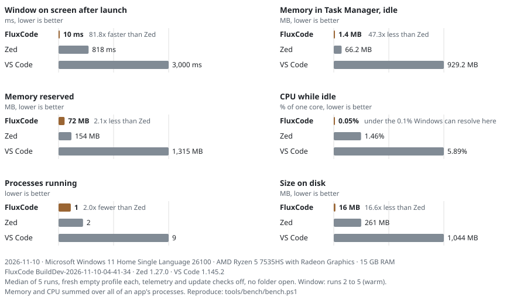

<!-- Made from README.flux by FluxCode (fluxcode --flux-to-md README.flux README.md). Edit README.flux, not this file. -->

# FluxCode

**English** · [Bahasa Indonesia](README.id.md) · [Changelog](CHANGELOG.md) · [Roadmap](ROADMAP.md) · [Discussions](https://github.com/MuaraAI/FluxCode/discussions)

Native GPU-rendered code editor written in Rust (GPUI) for Windows, macOS, and Linux.
Single 16 MB binary, ~50 ms startup, 1.4 MB idle RAM, built-in AI agent workspace, WizTree disk analyzer, and zero telemetry.

[](https://github.com/MuaraAI/FluxCode/releases/latest)
[](https://github.com/MuaraAI/FluxCode/commits/main)
[](https://github.com/MuaraAI/FluxCode/actions/workflows/build.yml)
[](LICENSE)

<a href="assets/screenshots/agent-workspace.png"></a>

## Key Strengths

| Area | What FluxCode Ships | Benefit |
| --- | --- | --- |
| **Footprint & Speed** | Rust + GPUI single 16 MB binary, ~50 ms launch, 1.4 MB idle RAM in 1 process. | No Electron/Chromium overhead; stays quiet in the background. |
| **Built-in AI Agents (ACP)** | Runs OpenCode 2, Claude Agent, Codex, Gemini CLI, Copilot, and any ACP registry agent with FIFO queue, context-aware Force Send (`Ctrl+Enter`), per-turn diff/undo, Token Saver, Browser DevTools MCP, and quota auto-resume. | Full agent workflow inside the editor with one-click setup and isolated Job Object lifecycle (close-to-tray while running, zero zombie processes on exit). |
| **Live Agent Optimization** | Newton cooling + critically damped Working Set trimming + Windows EcoQoS, plus Shannon delta context deduplication and Gibbs-Boltzmann context budgeting. | Keeps live agents like OpenCode 2 connected without auto-disabling, cutting idle RAM up to ~94% (~25 ms wake) and avoiding redundant file/workspace dumps. |
| **WizTree Disk Analyzer** | Pure-Rust parallel disk indexer (`Ctrl+Shift+Y`), interactive squarified treemap, extension breakdown, and `@wiztree` single-pass AI context. | Agents inspect folder sizes and bloat hotspots in 0-1 tool calls instead of slow directory scans. |
| **Multi-Language Terminal** | Multi-tab shell with inline `Tab` cycling, typo fixes, and clickable `file:line:col` error links across 15+ languages (Python, JS/TS, Rust, Go, Java, C/C++, C#, Zig, PowerShell, and more). | Click any compiler or runtime error to jump directly to the exact line and column. |
| **Non-Text & Game Files** | Editable SNBT for Minecraft Bedrock & Java NBT (`level.dat`, `level.dat_old`, `.mcstructure`, `.nbt`), read-only LevelDB, SQLite, PDF, Word/Excel/PowerPoint, ZIP/JAR, and Hex. | Open binary data, databases, and Office documents beside code with no extensions required. |
| **Git, Projects & WSL2** | Built-in Git (commit graph, background incoming fetch, `gh` PRs), 11 native project manifests (Paper, Bedrock add-ons, Gradle/Maven via FluxCompile, Rust, Node, Python, Go, C/C++, .NET), fast WSL2 disk helper, and GPU Markdown/`.flux` preview. | Ready out of the box on Windows, macOS, and Linux with zero plugin setup. |
| **VS Code Keys & Privacy** | Standard VS Code layout and shortcuts, native VS Code Marketplace theme import (with automatic 4.5:1 contrast safety), dockable sidebars, and zero telemetry. | Familiar muscle memory with no account wall or tracking. |

## Benchmark

<picture>
  <source media="(prefers-color-scheme: dark)" srcset="assets/benchmarks/benchmark-dark.svg">
  
</picture>

| Metric (lower is better) | FluxCode | Zed 1.27.0 | VS Code 1.145.2 |
| --- | --- | --- | --- |
| Window on screen | ~50 ms | 818 ms | ~3,000 ms |
| Idle RAM (Task Manager) | 1.4 MB | 66.2 MB | 929.2 MB |
| Reserved memory (commit) | 72 MB | 154 MB | 1,315 MB |
| Idle CPU (% of 1 core) | 0.05% | 1.46% | 5.89% |
| Processes | 1 | 2 | 9 |
| Size on disk | 16 MB | 261 MB | 1,044 MB |

*Median of 5 runs on Windows 11 (Ryzen 5 7535HS, 15 GB RAM, empty profile, Nov 2026). Raw data: [`tools/bench/results.json`](tools/bench/results.json) · Script: [`tools/bench/bench.ps1`](tools/bench/bench.ps1).*

## FluxCode vs Zed vs VS Code

| Feature | FluxCode | Zed | VS Code |
| --- | --- | --- | --- |
| Stack | Rust + GPUI | Rust + GPUI | TypeScript + Electron |
| Idle RAM / Disk | 1.4 MB / 16 MB (1 process) | 66.2 MB / 261 MB (2 processes) | 929.2 MB / 1,044 MB (9 processes) |
| Telemetry | None | On by default (opt-out) | On by default (opt-out) |
| AI Agents | Any ACP agent, FIFO queue + Force Send, live RAM/EcoQoS optimizer, Token Saver, Browser MCP, Copilot inline | Built-in + ACP agents | Copilot + extensions |
| Built-in Disk Analyzer | Yes (Rust WizTree + `@wiztree` AI context) | No | Extensions only |
| Non-Text & Game Files | Editable Bedrock/Java NBT, LevelDB, SQLite, PDF, Office, ZIP, Hex | Images | Images (+ extensions) |
| Language Servers (LSP) | Planned ([Roadmap](ROADMAP.md)) | Built in | Via extensions |
| Debugger | Run only (no debugger yet) | Yes | Yes |
| Extensions | Marketplace themes/grammars + 11 built-in manifests (no JS host) | Yes | Largest catalog |
| Remote | WSL2 fast disk helper | SSH | SSH, Containers, WSL |
| License | GPL-3.0-or-later | GPL-3.0 | MIT (OSS) / Microsoft |

## Download

Grab the latest build from [Releases](https://github.com/MuaraAI/FluxCode/releases/latest) (continuous builds from `main`, one-click in-app updates).

| Platform | Package | Install |
| --- | --- | --- |
| Windows 10/11 (x64) | `FluxCode-BuildDev-...-windows-x64-setup.exe` | Run installer (per-user, no admin required). |
| Windows Portable (x64) | `FluxCode-BuildDev-...-windows-x64.zip` | Extract and run `FluxCode.exe`. |
| macOS 11+ (Universal, preview) | `FluxCode-BuildDev-...-macos-universal.dmg` | Drag to Applications (first launch: **Privacy & Security > Open Anyway**). |
| Linux (x64, Vulkan) | `FluxCode-BuildDev-...-linux-x64.tar.gz` | Extract and run `./install.sh` (no root required). |

## Shortcuts

| Action | Keys | Action | Keys |
| --- | --- | --- | --- |
| AI Agent panel | `Ctrl+L` | Command Palette | `Ctrl+Shift+P` / `F1` |
| Force Send (Agent) | `Ctrl+Enter` | Go to File / Line | `Ctrl+P` / `Ctrl+G` |
| WizTree Disk Usage | `Ctrl+Shift+Y` | Find in Files | `Ctrl+Shift+F` |
| Toggle Terminal / New Tab | ``Ctrl+` `` / ``Ctrl+Shift+` `` | Run File / Stop | `F5` / `Shift+F5` |
| Sidebar / Bottom Panel | `Ctrl+B` / `Ctrl+J` | Settings / Next Theme | `Ctrl+,` / `Ctrl+K Ctrl+T` |

## Build & Docs

```sh
cargo build --release
cargo test --bin fluxcode
```

| Resource | Link |
| --- | --- |
| Release Notes | [CHANGELOG.md](CHANGELOG.md) |
| 2026-2027 Roadmap | [ROADMAP.md](ROADMAP.md) |
| Contributing & CI Checks | [CONTRIBUTING.md](CONTRIBUTING.md) |
| Flux Document Format | [docs/flux.md](docs/flux.md) |
| License | [GPL-3.0-or-later](LICENSE) · [Third-Party Notices](THIRD_PARTY_NOTICES.md) |
