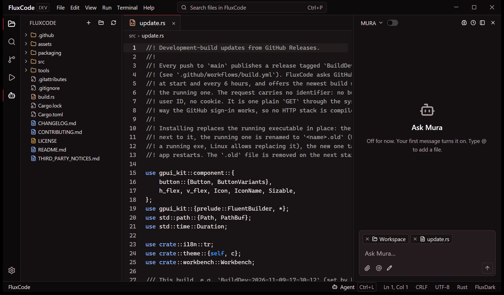

# FluxCode

A native code editor for Windows and Linux, written in Rust and drawn by the GPU.
One small program with an AI agent panel, a Python-friendly terminal, built-in Source
Control, and read-only views for files other editors refuse to open. No telemetry.

[](https://github.com/MuaraAI/FluxCode/releases/latest)
[](LICENSE)



FluxCode is in development. There are no version numbers yet: every change merged into
`main` becomes a build named after the moment it was made, like
`BuildDev-2026-11-09-17-30-12`, and installed copies offer it on their own.

## Download

Get the newest build from [Releases](https://github.com/MuaraAI/FluxCode/releases/latest).

| System | File | Install |
| --- | --- | --- |
| Windows 10/11, x64 | `FluxCode-BuildDev-...-windows-x64.zip` | Extract, double-click `Install.cmd`. No admin rights. |
| Linux, x64 (glibc 2.35+, Vulkan) | `FluxCode-BuildDev-...-linux-x64.tar.gz` | Extract, run `./install.sh`. No root. |

Both install for your user only and keep themselves up to date: when a new build is out,
a card in the bottom-right corner offers it, and one click downloads it, swaps the
program and reopens your folders. Settings > Updates turns the check off.

## What it does

- **Editor**: syntax colors for about 200 languages (picked by file name, extension or
  `#!` line), multi-root workspaces, drag a folder onto the window to add or switch,
  Go to File (`Ctrl+P`), Find in Files, smooth wheel scrolling, auto save, four themes,
  your own background image, English or Bahasa Indonesia.
- **Files that are not text** open read-only instead of failing: binaries as hex, Word,
  Excel, PowerPoint, OpenDocument and PDF as text, ZIP/JAR/APK as a file list, SQLite as
  tables with their SQL and row counts.
- **AI agent panel** (`Ctrl+L`) for any [ACP](https://agentclientprotocol.com) agent:
  [OpenCode](https://opencode.ai) or MuaraAI's Mura. Pick the model, effort and mode in
  the panel; choose Read only, Read & write or Full access; see every file the agent
  changed this turn with a diff and per-file undo; edit a sent message and the answer
  restarts from there. The agent gets an overview of the workspace with its first message,
  and a local memory you can read, edit or switch off.
- **Terminal and Run** (`F5`): Python errors become a card with a clickable file and line
  and, for a missing module, a Fix button; typos like `pip i` are corrected before running.
- **Source Control** (`Ctrl+Shift+G`): stage, commit, push, pull, sync, amend, a commit
  graph, pull requests and GitHub Actions runs through `gh`, and Remove Git to undo a
  `git init`. Thousands of untracked files stay fast, with a one-click `.gitignore`.

## FluxCode, Zed and VS Code

All three are good editors made for different people. This is where each stands today.

| | FluxCode | Zed | VS Code |
| --- | --- | --- | --- |
| Built with | Rust, GPUI (GPU-drawn) | Rust, GPUI (GPU-drawn) | TypeScript on Electron (Chromium + Node.js) |
| Systems | Windows, Linux | macOS, Linux, Windows | Windows, macOS, Linux, web |
| What you download | one program, about 16 MB | an installer | an installer |
| Telemetry | none | on by default, can be turned off | on by default in Microsoft's build, can be turned off |
| Language smarts (go to definition, rename, diagnostics) | not yet: colors and word completion | built in, through language servers | through extensions |
| Debugger | not yet (Run only) | yes | yes |
| Extensions | none | yes | the largest catalog |
| AI agent | any ACP agent, three access levels, per-turn changes with undo, local memory | its own agent and ACP agents | GitHub Copilot and extensions |
| Files that are not text | hex, PDF, Office, ZIP, SQLite (read-only) | images | images; more through extensions |
| Real-time collaboration | no | built in | Live Share extension |
| Remote development | no | SSH | SSH, containers, WSL |
| Interface languages | English, Bahasa Indonesia | English | many, through language packs |
| Maturity | development builds | stable releases | stable, widely used |
| License | GPL-3.0-or-later | GPL-3.0 (the editor) | MIT for Code - OSS; Microsoft's build has its own license |

**Pick FluxCode** if you want a small, quiet editor on Windows or Linux with an agent you
can keep on a short leash, and you open logs, databases and documents next to your code.
**Pick Zed** for macOS, language servers out of the box and pair programming.
**Pick VS Code** when you need a specific extension, a debugger or remote development.

## Privacy

FluxCode sends nothing about you. The only request it makes by itself is the update
check: a plain `GET` of the release list from github.com, with no build ID, machine ID or
cookie, at start and every 6 hours (Settings > Updates turns it off). Everything else goes
out only when you start it: the agent you run, `git`, and GitHub when you sign in.

## Shortcuts

| Action | Keys |
| --- | --- |
| Go to File / Find in Files | `Ctrl+P` / `Ctrl+Shift+F` |
| Open File / Open Folder | `Ctrl+O` / `Ctrl+K Ctrl+O` |
| Save / Save All / Close tab | `Ctrl+S` / `Ctrl+Alt+S` / `Ctrl+W` |
| Agent panel | `Ctrl+L` |
| Explorer / Source Control / Run | `Ctrl+Shift+E` / `Ctrl+Shift+G` / `Ctrl+Shift+D` |
| Side bar / Panel / Terminal | `Ctrl+B` / `Ctrl+J` / ``Ctrl+` `` |
| Run file / Stop | `F5` / `Shift+F5` |
| Settings / Next theme | `Ctrl+,` / `Ctrl+K Ctrl+T` |

## Build from source

Rust stable, then:

```sh
cargo build --release          # target/release/fluxcode(.exe)
cargo test --bin fluxcode
```

- **Windows**: HLSL shaders need `fxc.exe` from the Windows SDK, or set `GPUI_FXC_PATH`
  to `tools/fxc-shim` built with `cargo build --release --manifest-path tools/fxc-shim/Cargo.toml`.
  With the GNU toolchain, use a `CARGO_TARGET_DIR` without spaces (MinGW `windres`).
  `packaging/windows/build.ps1 -Install` builds, packs and installs like a release.
- **Linux**: `pkg-config clang libxkbcommon-dev libxkbcommon-x11-dev libwayland-dev
  libx11-xcb-dev libxcb1-dev libfontconfig1-dev libfreetype6-dev libvulkan-dev` (Debian
  and Ubuntu names).
- Builds name themselves from `FLUXCODE_BUILD` (`BuildDev-YYYY-MM-DD-HH-MM-SS`); without
  it, from the current UTC time.

## Contributing

FluxCode is open source, and **issues are open to everyone**: report a bug or suggest an
idea through [Issues](https://github.com/MuaraAI/FluxCode/issues/new/choose). A bot
checks each new issue for earlier reports of the same problem and for an outdated build.

**Pull requests are accepted only from members of the MuaraAI organization**; others are
closed automatically. Details in [CONTRIBUTING.md](CONTRIBUTING.md). What changed in each
build: [CHANGELOG.md](CHANGELOG.md).

## License

[GPL-3.0-or-later](LICENSE). Third-party components: [THIRD_PARTY_NOTICES.md](THIRD_PARTY_NOTICES.md).
