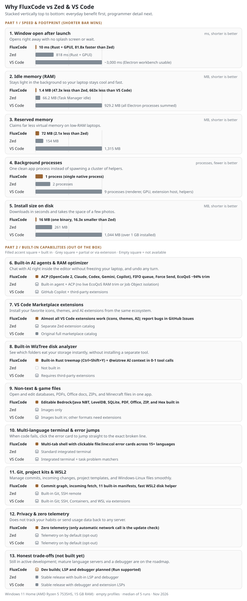

<!-- Made from README.flux by FluxCode (fluxcode --flux-to-md README.flux README.md). Edit README.flux, not this file. -->

# FluxCode

**English** · [Bahasa Indonesia](README.id.md) · [Changelog](CHANGELOG.md) · [Roadmap](ROADMAP.md) · [Discussions](https://github.com/MuaraAI/FluxCode/discussions)

Native GPU-rendered code editor in Rust (GPUI) for Windows, macOS, and Linux.
Single 16 MB binary, 10 ms launch, 1.4 MB idle RAM, built-in AI agents, WizTree disk analyzer, zero telemetry.

[](https://github.com/MuaraAI/FluxCode/releases/latest)
[](https://github.com/MuaraAI/FluxCode/commits/main)
[](https://github.com/MuaraAI/FluxCode/actions/workflows/build.yml)
[](LICENSE)

<a href="assets/screenshots/agent-workspace.png"></a>

## Key Strengths

| Feature | Highlights |
| --- | --- |
| **Speed & Size** | Rust + GPUI, 16 MB binary, 10 ms launch, 1.4 MB idle RAM (1 process) |
| **AI Agents (ACP)** | OpenCode 2, Claude, Codex, Gemini, Copilot; FIFO queue, Force Send (`Ctrl+Enter`), diff/undo |
| **Live RAM Optimizer** | Trims idle agent RAM up to ~94% (~25 ms wake) via Windows EcoQoS and delta context |
| **Agent Lifecycle** | Isolated Job Object, close-to-tray while active, zero zombie processes on exit |
| **WizTree Disk Analyzer** | Built-in Rust treemap (`Ctrl+Shift+Y`) + `@wiztree` AI context in 0-1 tool calls |
| **Multi-Language Terminal** | Multi-tab shell with clickable `file:line:col` error jumps across 15+ languages |
| **Non-Text & Game Files** | Editable Bedrock/Java NBT, LevelDB, SQLite, PDF, Office, ZIP, and Hex |
| **Git, Projects & WSL2** | Commit graph, incoming fetch, 11 built-in project manifests, fast WSL2 helper |
| **VS Code Extensions** | Almost all VS Code extensions supported (icons, themes, AI, and more); report extension bugs in [Issues](https://github.com/MuaraAI/FluxCode/issues) |
| **Privacy & Keys** | VS Code layout and shortcuts, zero telemetry |

## Benchmark

<picture>
  <source media="(prefers-color-scheme: dark)" srcset="assets/benchmarks/benchmark-dark.svg">
  
</picture>

| Metric (lower is better) | FluxCode | Zed 1.27.0 | VS Code 1.145.2 |
| --- | --- | --- | --- |
| Launch to window | 10 ms | 818 ms | ~3,000 ms |
| Idle RAM (Task Manager) | 1.4 MB | 66.2 MB | 929.2 MB |
| Reserved memory | 72 MB | 154 MB | 1,315 MB |
| Idle CPU (% of 1 core) | 0.05% | 1.46% | 5.89% |
| Processes | 1 | 2 | 9 |
| Size on disk | 16 MB | 261 MB | 1,044 MB |

*Median of 5 runs on Windows 11 (Ryzen 5 7535HS, 15 GB RAM, empty profile, Nov 2026). Data: [`tools/bench/results.json`](tools/bench/results.json) · Script: [`tools/bench/bench.ps1`](tools/bench/bench.ps1).*

## FluxCode vs Zed vs VS Code

<picture>
  <source media="(prefers-color-scheme: dark)" srcset="assets/benchmarks/advantages-dark.svg">
  
</picture>

| Feature | FluxCode | Zed | VS Code |
| --- | --- | --- | --- |
| Engine | Rust + GPUI | Rust + GPUI | TypeScript + Electron |
| Launch / Idle RAM | 10 ms / 1.4 MB | 818 ms / 66.2 MB | ~3,000 ms / 929.2 MB |
| Disk / Processes | 16 MB / 1 | 261 MB / 2 | 1,044 MB / 9 |
| Telemetry | None | Opt-out | Opt-out |
| AI Agents | ACP, queue, Force Send, EcoQoS, Token Saver | Built-in + ACP | Copilot + extensions |
| Disk Analyzer | Built-in WizTree + `@wiztree` | No | Extensions only |
| Non-Text & NBT | Editable NBT, LevelDB, SQLite, PDF, Office, Hex | Images | Images (+ extensions) |
| LSP / Debugger | Planned / Run only | Yes / Yes | Extensions / Yes |
| Extensions | Almost all VS Code extensions (icons, themes, AI); [report bugs](https://github.com/MuaraAI/FluxCode/issues) | Yes | Largest catalog |
| Remote | WSL2 fast helper | SSH | SSH, Containers, WSL |
| License | GPL-3.0-or-later | GPL-3.0 | MIT / Microsoft |

## Download

Latest builds: [Releases](https://github.com/MuaraAI/FluxCode/releases/latest) (continuous builds from `main`, one-click in-app updates).

| Platform | Package | Install |
| --- | --- | --- |
| Windows (x64) | `...-windows-x64-setup.exe` | Run installer (per-user, no admin) |
| Windows Portable | `...-windows-x64.zip` | Extract and run `FluxCode.exe` |
| macOS (preview) | `...-macos-universal.dmg` | Drag to Applications (**Open Anyway** once) |
| Linux (x64, Vulkan) | `...-linux-x64.tar.gz` | Extract and run `./install.sh` |

## Shortcuts

| Action | Keys | Action | Keys |
| --- | --- | --- | --- |
| AI Agent panel | `Ctrl+L` | Command Palette | `Ctrl+Shift+P` / `F1` |
| Force Send (Agent) | `Ctrl+Enter` | Go to File / Line | `Ctrl+P` / `Ctrl+G` |
| WizTree Disk Usage | `Ctrl+Shift+Y` | Find in Files | `Ctrl+Shift+F` |
| Terminal / New Tab | ``Ctrl+` `` / ``Ctrl+Shift+` `` | Run File / Stop | `F5` / `Shift+F5` |
| Sidebar / Panel | `Ctrl+B` / `Ctrl+J` | Settings / Next Theme | `Ctrl+,` / `Ctrl+K Ctrl+T` |

## Build & Docs

```sh
cargo build --release
cargo test --bin fluxcode
```

| Resource | Link |
| --- | --- |
| Release Notes | [CHANGELOG.md](CHANGELOG.md) |
| 2026-2027 Roadmap | [ROADMAP.md](ROADMAP.md) |
| Contributing & CI | [CONTRIBUTING.md](CONTRIBUTING.md) |
| Flux Format | [docs/flux.md](docs/flux.md) |
| License | [GPL-3.0-or-later](LICENSE) · [Third-Party Notices](THIRD_PARTY_NOTICES.md) |
