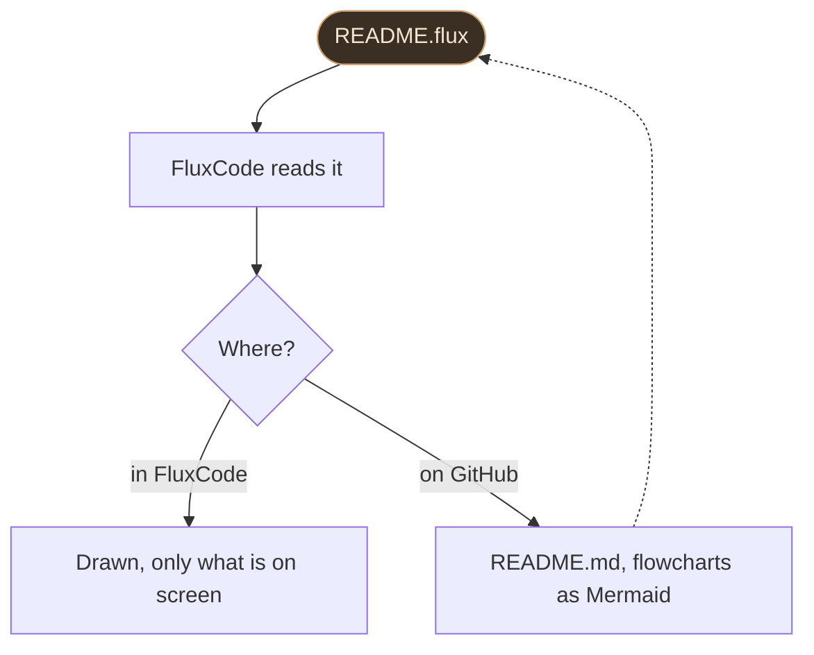

<!-- Made from docs/flux.flux by FluxCode (fluxcode --flux-to-md docs/flux.flux docs/flux.id.md). Edit docs/flux.flux, not this file. -->

# Flux documents

File `.flux` adalah dokumen teks: semua yang ditulis Markdown, ditambah blok untuk hal
yang diserahkan Markdown ke HTML atau memang tidak ada padanannya. FluxCode membukanya
dalam bentuk tergambar, dan mengubahnya jadi Markdown GitHub saat harus dibaca di GitHub
(`README.md` milik FluxCode sendiri dibuat dari `README.flux` dengan cara ini).

- [Kenapa format lain](#kenapa-format-lain)
- [Kenapa tetap ringan](#kenapa-tetap-ringan)
- [Teks](#teks)
- [Tabel](#tabel)
- [Gambar, GIF, dan video](#gambar-gif-dan-video)
- [Flowchart](#flowchart)
- [Callout, details, dan kolom](#callout-details-dan-kolom)
- [Bahasa](#bahasa)
- [Tampilan halaman](#tampilan-halaman)
- [Di GitHub](#di-github)

## Kenapa format lain

Markdown bagus untuk paragraf dan daftar. Sisanya (lebar gambar, gambar untuk tema gelap,
bagian yang bisa dilipat, callout, flowchart, dua gambar berdampingan) berarti menulis
HTML di dalamnya, dan HTML lebih sulit dibaca, ditulis, dan dijaga bentuknya, baik oleh
manusia maupun model AI. Flux memberi masing-masing hal itu satu direktif sebaris.

| | Markdown | Flux |
| --- | --- | --- |
| Teks, heading, daftar, kode, tautan | ada | sintaks yang sama |
| Tabel | tabel pipa | tabel pipa, atau `@table` dengan perataan dan lebar kolom |
| Lebar gambar, perataan, versi tema gelap | HTML | `@image ... width= align= dark=` |
| Gambar berdampingan | HTML | `@gallery` |
| Video | sebuah tautan | `@video` dengan poster; FluxCode memutarnya di player sistem |
| Flowchart | Mermaid hanya di GitHub | `@flow`, digambar FluxCode; Mermaid di GitHub |
| Callout | `> [!NOTE]` milik GitHub | `@note`, `@tip`, `@warn`, `@danger` |
| Bagian yang bisa dilipat | HTML `<details>` | `@details` |
| Kolom | tidak ada | `@columns` ... `@col` ... `@end` |
| Daftar isi | ditulis tangan | `@toc` |
| Tombol, badge, teks berwarna | HTML atau tidak ada | `{kbd Ctrl+S}`, `{badge New}`, `{color=#d0a070 text}` |
| Satu file, beberapa bahasa | tidak ada | bagian `@en`, `@id`, `@all` |
| Tampilan halaman | bawaan viewer | `@style accent= width= size= font=` |

## Kenapa tetap ringan

- **Satu kali lintas, tanpa salinan.** Tiap blok menyimpan letak teksnya di file (16 byte
  per blok); bold, tautan, dan tombol hanya dihitung untuk blok yang sedang digambar.
- **Hanya yang terlihat yang digambar.** Tiap baris tabel dan item daftar adalah blok
  tersendiri, dan jendela menyimpan blok dalam grup kecil (heading memulai satu grup),
  hanya menata grup yang ada di layar.
- **Layar pertama langsung tampil.** Dokumen di atas 256 KB menampilkan 32 KB pertamanya
  seketika; sisanya dibaca di thread lain lalu menggantikan tempatnya.
- **Teks besar disimpan padat.** Di atas 1 MB, teks disimpan terkompresi DEFLATE dalam
  frame 64 KB, dan penggambaran hanya membuka frame yang ada di layar (enam tetap terbuka).
- **Tanpa salinan kedua.** Editor di balik **Source** baru diisi saat Source pertama kali
  ditampilkan, jadi dokumen di atas 2 MB terbuka tanpa editor ikut menyimpan teksnya.

Diukur dengan `cargo test --release --bin fluxcode million_lines -- --ignored --nocapture`
di AMD Ryzen 5 7535HS, untuk dokumen 1.300.003 baris (31,8 MB: heading, daftar, tabel
200.000 baris, paragraf):

| Langkah | Waktu | Memori |
| --- | ---: | ---: |
| Bagian pertama (31 KB, 1.264 blok), langsung digambar | 0,083 ms | |
| Seluruh dokumen terbaca | 49 ms (647 MB/detik) | 900.001 blok, 14,4 MB |
| ... dan teksnya dipadatkan | total 102 ms, di luar layar | 31,8 MB teks tersimpan dalam 2,3 MB |
| Bold, tautan, dan tombol untuk satu layar (40 blok) | 0,04 ms | |

Dibuka di FluxCode (build release, profil baru, tiga kali pengukuran):

| Dokumen | Jendela tampil | Task Manager, 9 detik setelah start | Memori direservasi |
| --- | ---: | ---: | ---: |
| Halaman ini | 0,28 sampai 0,30 detik | 5,0 MB | 47,6 MB |
| Dokumen 1.300.003 baris, dengan `@toc` | 0,28 sampai 0,29 detik | 16 MB | 81,5 MB |
| Tanpa dokumen (sebagai pembanding) | 0,26 sampai 0,30 detik | 6,3 sampai 6,9 MB | 51,3 sampai 51,9 MB |

> [!NOTE]
> **Yang tidak dijanjikan di sini**
> Teks padat di atas adalah dokumen uji yang berulang; teks biasa memadat sekitar tiga
> sampai empat kali. Tampilan Source adalah editor biasa, jadi membuka Source pada dokumen
> sangat besar menyimpan seluruh teksnya lagi. "Memori direservasi" adalah yang sudah
> diklaim proses (private bytes Windows); Task Manager menampilkan bagian yang ada di RAM.

## Teks

Paragraf, heading, dan daftar ditulis seperti di Markdown.

```flux
# A heading
## A smaller one

A paragraph can run over several lines.
A blank line ends it.

- a list item
  - nested two spaces in
- [x] a done task
1. a numbered item

> A quote.

---
```

Sebaris: **bold** `**bold**`, *miring* `*miring*`, `kode` dengan backtick, ~~coret~~
`~~coret~~`, **sorot** `==sorot==`, [tautan](https://github.com/MuaraAI/FluxCode)
`[tautan](url)` (`https://...` telanjang juga jadi tautan), tombol <kbd>Ctrl+Shift+P</kbd>
`{kbd Ctrl+Shift+P}`, badge `New` `{badge New}`, dan teks berwarna
`{color=#5fd38d teks berwarna}`. Backslash menjaga karakter tetap apa adanya: `\*`.

Baris yang dimulai dengan `//` adalah komentar: tidak pernah ditampilkan.

## Tabel

Tabel pipa bekerja seperti di GitHub; baris di bawah header menentukan perataannya.

```flux
| Editor | Start | Memory |
| :--- | ---: | :---: |
| FluxCode | 0.22 s | 1.4 MB |
```

`@table` tidak butuh pipa di ujung baris dan menerima opsi:

```flux
@table align=l,r,r widths=3,1,1
Editor | Start | Memory
FluxCode | 0.22 s | 1.4 MB
Zed | 0.82 s | 66 MB
@end
```

| Editor | Start | Memory |
| --- | ---: | ---: |
| FluxCode | 0.22 s | 1.4 MB |
| Zed | 0.82 s | 66 MB |
| VS Code | 0.29 s | 929 MB |

`align=` menerima `l`, `c`, atau `r` per kolom, `widths=` lebar relatif, dan `header=none`
membuat baris pertama jadi baris biasa. Tabel boleh punya baris sebanyak apa pun:
FluxCode hanya menggambar yang ada di layar.

## Gambar, GIF, dan video

```flux
@image assets/icon.png width=96 alt="The FluxCode icon"
@image chart-light.svg dark=chart-dark.svg width=100% alt="A chart"
@image demo.gif width=60% caption="A GIF plays as it is" link=demo.gif
@video intro.mp4 poster=intro.png alt="A one-minute tour"
```

- `width=` dalam piksel atau sebagai bagian halaman (`60%`); `align=right` membuatnya
  mengambang ke kanan.
- `dark=` ditampilkan sebagai gantinya saat temanya gelap (di GitHub juga, lewat
  `<picture>`).
- `link=` adalah yang terbuka saat diklik; `caption=` tampil di bawahnya.
- GIF diputar di FluxCode apa adanya. Gambar dari web tidak diambil: dokumen tetap
  offline, dan menampilkan tautan sebagai gantinya.
- `@video` menampilkan poster dengan tombol putar; satu klik memutarnya di player sistem
  (FluxCode tidak punya dekoder video, itulah yang menjaganya tetap 16 MB). Di GitHub
  bentuknya poster yang menautkan ke videonya.


Dua gambar atau lebih berdampingan:

```flux
@gallery
@image before.png width=49% alt="Before"
@image after.png width=49% alt="After"
@end
```

## Flowchart

```flux
@flow down
src([README.flux]) -> read[FluxCode reads it]
read -> view{Where?}
view -in FluxCode-> draw[Drawn, only what is on screen]
view -on GitHub-> md[README.md, flowcharts as Mermaid]
md ..> src
style src fill=#3a2f22 text=#f2e6d0 border=#d0a070
@end
```



- Simpul: `id[Kotak]`, `id(Bulat)`, `id([Pil])`, `id{Keputusan}`, `id((Lingkaran))`.
  Simpul dideklarasikan saat pertama kali diberi label; setelah itu cukup id-nya.
- Sisi: `a -> b`, dengan label `a -ya-> b`, putus-putus `a ..> b`; bisa dirangkai:
  `a -> b -> c`.
- `style id fill=#hex text=#hex border=#hex` mewarnai satu simpul.
- `@flow right` menatanya dari kiri ke kanan alih-alih dari atas ke bawah.
- FluxCode menatanya sendiri per lapis, dan sisi yang naik kembali (loop) lewat di sisi.
  Di GitHub bentuknya jadi flowchart Mermaid, yang digambar GitHub.

## Callout, details, dan kolom

```flux
@tip Keep it short
One idea per callout.
@end

@details What happens on GitHub
A collapsed section, opened with a click.
@end

@columns
Left column.
@col
Right column.
@end
```

> [!TIP]
> **Ringkas saja**
> `@note`, `@tip`, `@warn`, dan `@danger` masing-masing punya warna dan ikonnya. Teks
> setelah direktif adalah judulnya.

<details><summary>Apa yang terjadi di GitHub</summary>

`@details` menjadi `<details><summary>`, dan callout menjadi alert milik GitHub
(`> [!NOTE]`, `> [!TIP]`, `> [!WARNING]`, `> [!CAUTION]`).

</details>

**Kolom** tampil berdampingan di jendela lebar dan bertumpuk di jendela sempit.


Di GitHub, yang tidak punya kolom, keduanya tampil berurutan.

## Bahasa

Satu file bisa memuat teks yang sama dalam beberapa bahasa. FluxCode menampilkan bagian
sesuai bahasa antarmukanya (Settings > Language); `@all` kembali ke teks untuk semua.

```flux
@en
FluxCode starts in 0.22 s.
@id
FluxCode terbuka dalam 0,22 detik.
@all
```

`changelog.flux`, catatan rilis yang ditampilkan FluxCode setelah update, memakai ini
bersama `@release DATE` dan `@title en: ...` / `@title id: ...`.

## Tampilan halaman

```flux
@style accent=#d0a070 width=880 size=15 font="Segoe UI"
```

`accent` mewarnai tautan, butir daftar, dan garis bawah judul; `width` lebar kolom teks
dalam piksel; `size` ukuran teks; `font` jenis hurufnya. Yang tidak disetel mengikuti tema
FluxCode.

## Di GitHub

GitHub hanya menggambar beberapa format sebagai dokumen (Markdown, reStructuredText,
AsciiDoc, Org, dan beberapa yang lebih lama). Karena itu README Flux selalu disertai
`README.md` hasil turunannya:

```text
fluxcode --flux-to-md README.flux README.md
fluxcode --flux-to-md README.flux README.md --check
```

Baris kedua tidak mengubah apa pun dan gagal kalau `README.md` sudah usang; test FluxCode
menjalankan pemeriksaan yang sama, jadi keduanya tidak bisa melenceng. Di FluxCode,
**Save as Markdown** di atas dokumen Flux melakukan hal yang sama untuk file yang sedang
terbuka.

Tambahkan `--lang id` untuk menulis bagian Indonesianya saja (README FluxCode sendiri
tersedia sebagai `README.md` dan `README.id.md`). Bahasa Inggris adalah bawaannya, karena
itu yang dibutuhkan pembaca pertama kali di GitHub.

> [!WARNING]
> **Nama .flux di GitHub**
> Daftar bahasa GitHub (Linguist) sudah punya bahasa bernama FLUX dengan ekstensi `.flux`,
> jadi GitHub memberi label itu pada file-file ini. `.gitattributes` di repositori ini
> menandai `.flux` sebagai Markdown sebagai gantinya. Linguist hanya menambah format
> setelah dipakai luas (paling sedikit 2.000 file dalam setahun di banyak repositori), jadi
> Flux belum bisa terdaftar di sana.
