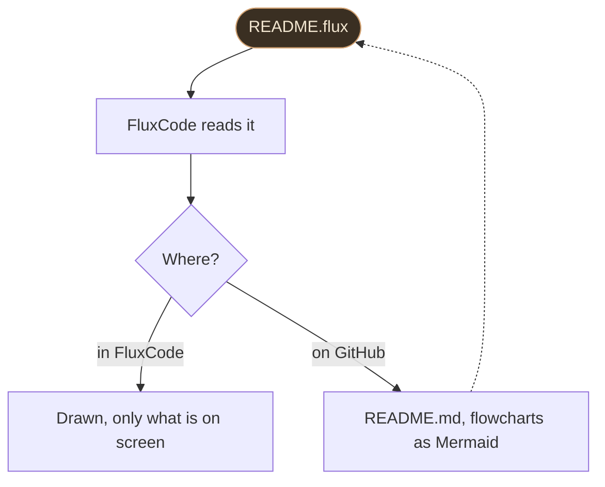

<!-- Made from docs/flux.flux by FluxCode (fluxcode --flux-to-md docs/flux.flux docs/flux.md). Edit docs/flux.flux, not this file. -->

# Flux documents

A `.flux` file is a text document: everything Markdown writes, plus blocks for what
Markdown hands to HTML or doesn't have at all. FluxCode opens it drawn, and turns it into
GitHub Markdown when it has to be read on GitHub (FluxCode's own `README.md` is made
from `README.flux` this way).

- [Why another format](#why-another-format)
- [How it stays light](#how-it-stays-light)
- [Text](#text)
- [Tables](#tables)
- [Images, GIFs and video](#images-gifs-and-video)
- [Flowcharts](#flowcharts)
- [Callouts, details and columns](#callouts-details-and-columns)
- [Languages](#languages)
- [The page's look](#the-pages-look)
- [On GitHub](#on-github)

## Why another format

Markdown is good at paragraphs and lists. Everything else (an image's width, a picture
for dark themes, a collapsible section, a callout, a flowchart, two images side by side)
means writing HTML inside it, and HTML is harder to read, to write and to keep in shape,
for people and for AI models alike. Flux gives each of those a one-line directive.

| | Markdown | Flux |
| --- | --- | --- |
| Text, headings, lists, code, links | yes | the same syntax |
| Tables | pipe tables | pipe tables, or `@table` with alignment and column widths |
| Image width, alignment, dark-theme version | HTML | `@image ... width= align= dark=` |
| Images side by side | HTML | `@gallery` |
| Video | a link | `@video` with a poster; FluxCode plays it in the system's player |
| Flowcharts | Mermaid on GitHub only | `@flow`, drawn by FluxCode; Mermaid on GitHub |
| Callouts | GitHub's `> [!NOTE]` | `@note`, `@tip`, `@warn`, `@danger` |
| Collapsible sections | HTML `<details>` | `@details` |
| Columns | no | `@columns` ... `@col` ... `@end` |
| Table of contents | by hand | `@toc` |
| Keys, badges, colored text | HTML or no | `{kbd Ctrl+S}`, `{badge New}`, `{color=#d0a070 text}` |
| One file, several languages | no | `@en`, `@id`, `@all` sections |
| Look of the page | the viewer's | `@style accent= width= size= font=` |

## How it stays light

- **One pass, nothing copied.** Each block keeps where its text is in the file (16 bytes a
  block); bold, links and keys are worked out only for the blocks being drawn.
- **Only what is on screen is drawn.** Every table row and list item is a block of its
  own, and the window holds the blocks in small groups (a heading starts one), laying out
  only the groups in view.
- **First screen at once.** A document over 256 KB shows its first 32 KB straight away;
  the rest is read on another thread and takes its place.
- **Large text kept packed.** Over 1 MB, the text is kept DEFLATE-packed in 64 KB frames,
  and drawing unpacks only the frames on screen (six stay unpacked).
- **No second copy.** The editor behind **Source** is filled the first time Source is
  shown, so a document over 2 MB opens without an editor holding its text too.

Measured with `cargo test --release --bin fluxcode million_lines -- --ignored --nocapture`
on an AMD Ryzen 5 7535HS, for a document of 1,300,003 lines (31.8 MB: headings, lists, a
200,000-row table, paragraphs):

| Step | Time | Memory |
| --- | ---: | ---: |
| First part (31 KB, 1,264 blocks), drawn at once | 0.083 ms | |
| The whole document read | 49 ms (647 MB/s) | 900,001 blocks, 14.4 MB |
| ... and its text packed | 102 ms in all, off screen | 31.8 MB of text kept in 2.3 MB |
| Bold, links and keys for one screen (40 blocks) | 0.04 ms | |

Opened in FluxCode (release build, fresh profile, three runs each):

| Document | Window on screen | Task Manager, 9 s after launch | Memory reserved |
| --- | ---: | ---: | ---: |
| This page | 0.28 to 0.30 s | 5.0 MB | 47.6 MB |
| The 1,300,003-line document, with a `@toc` | 0.28 to 0.29 s | 16 MB | 81.5 MB |
| No document (for comparison) | 0.26 to 0.30 s | 6.3 to 6.9 MB | 51.3 to 51.9 MB |

> [!NOTE]
> **What this does not promise**
> The packed text above is a repetitive test document; ordinary text packs about three to
> four times. The source view is an ordinary editor, so opening Source on a very large
> document holds the whole text again. "Memory reserved" is what the process has claimed
> (Windows' private bytes); Task Manager shows the part of it in RAM.

## Text

Paragraphs, headings and lists are written as in Markdown.

```flux
# A heading
## A smaller one

A paragraph can run over several lines.
A blank line ends it.

- a list item
  - nested two spaces in
- [x] a done task
1. a numbered item

> A quote.

---
```

Inline: **bold** `**bold**`, *italic* `*italic*`, `code` with backquotes, ~~struck~~
`~~struck~~`, **highlighted** `==highlighted==`, [a link](https://github.com/MuaraAI/FluxCode)
`[a link](url)` (a bare `https://...` is a link too), a key <kbd>Ctrl+Shift+P</kbd>
`{kbd Ctrl+Shift+P}`, a badge `New` `{badge New}` and colored text
`{color=#5fd38d colored text}`. A backslash keeps a character as it is: `\*`.

Lines starting with `//` are comments: they never show.

## Tables

A pipe table works as on GitHub; the line under the header sets the alignment.

```flux
| Editor | Start | Memory |
| :--- | ---: | :---: |
| FluxCode | 0.22 s | 1.4 MB |
```

`@table` needs no pipes at the ends and takes options:

```flux
@table align=l,r,r widths=3,1,1
Editor | Start | Memory
FluxCode | 0.22 s | 1.4 MB
Zed | 0.82 s | 66 MB
@end
```

| Editor | Start | Memory |
| --- | ---: | ---: |
| FluxCode | 0.22 s | 1.4 MB |
| Zed | 0.82 s | 66 MB |
| VS Code | 0.29 s | 929 MB |

`align=` takes `l`, `c` or `r` per column, `widths=` relative widths, and
`header=none` makes the first row an ordinary one. A table can have any number of rows:
FluxCode draws only those on screen.

## Images, GIFs and video

```flux
@image assets/icon.png width=96 alt="The FluxCode icon"
@image chart-light.svg dark=chart-dark.svg width=100% alt="A chart"
@image demo.gif width=60% caption="A GIF plays as it is" link=demo.gif
@video intro.mp4 poster=intro.png alt="A one-minute tour"
```

- `width=` in pixels or as a share of the page (`60%`); `align=right` floats it right.
- `dark=` is shown instead when the theme is dark (on GitHub too, through `<picture>`).
- `link=` is what a click opens; `caption=` goes under it.
- A GIF plays in FluxCode as it is. Images from the web aren't fetched: the document
  stays offline, and shows a link instead.
- `@video` shows the poster with a play button; a click plays the video in the system's
  player (FluxCode has no video decoder, which keeps it at 16 MB). On GitHub it is the
  poster linked to the video.


Two or more images side by side:

```flux
@gallery
@image before.png width=49% alt="Before"
@image after.png width=49% alt="After"
@end
```

## Flowcharts

```flux
@flow down
src([README.flux]) -> read[FluxCode reads it]
read -> view{Where?}
view -in FluxCode-> draw[Drawn, only what is on screen]
view -on GitHub-> md[README.md, flowcharts as Mermaid]
md ..> src
style src fill=#3a2f22 text=#f2e6d0 border=#d0a070
@end
```



- Nodes: `id[Box]`, `id(Rounded)`, `id([Pill])`, `id{Decision}`, `id((Circle))`. A node
  is declared the first time it has a label; after that its id is enough.
- Edges: `a -> b`, with a label `a -yes-> b`, dashed `a ..> b`; they chain:
  `a -> b -> c`.
- `style id fill=#hex text=#hex border=#hex` colors one node.
- `@flow right` lays it out from left to right instead of top to bottom.
- FluxCode lays it out by itself in layers, and edges that go back up (loops) run along
  the side. On GitHub it becomes a Mermaid flowchart, which GitHub draws.

## Callouts, details and columns

```flux
@tip Keep it short
One idea per callout.
@end

@details What happens on GitHub
A collapsed section, opened with a click.
@end

@columns
Left column.
@col
Right column.
@end
```

> [!TIP]
> **Keep it short**
> `@note`, `@tip`, `@warn` and `@danger` each have their color and icon. The text after the
> directive is the title.

<details><summary>What happens on GitHub</summary>

`@details` becomes `<details><summary>`, and callouts become GitHub's alerts
(`> [!NOTE]`, `> [!TIP]`, `> [!WARNING]`, `> [!CAUTION]`).

</details>

**Columns** sit side by side on a wide window and one under the other on a narrow one.


On GitHub, which has no columns, they come one after the other.

## Languages

One file can hold the same text in several languages. FluxCode shows the sections for
its interface language (Settings > Language); `@all` goes back to text for everyone.

```flux
@en
FluxCode starts in 0.22 s.
@id
FluxCode terbuka dalam 0,22 detik.
@all
```

`changelog.flux`, the release notes FluxCode shows after an update, uses this with
`@release DATE` and `@title en: ...` / `@title id: ...`.

## The page's look

```flux
@style accent=#d0a070 width=880 size=15 font="Segoe UI"
```

`accent` colors links, list bullets and the title's underline; `width` is the text
column in pixels; `size` the text size; `font` the typeface. Anything not set follows
the FluxCode theme.

## On GitHub

GitHub only draws a few formats as documents (Markdown, reStructuredText, AsciiDoc, Org
and some older ones). A Flux README therefore comes with the `README.md` made from it:

```text
fluxcode --flux-to-md README.flux README.md
fluxcode --flux-to-md README.flux README.md --check
```

The second line changes nothing and fails when `README.md` is out of date; FluxCode's
tests run the same check, so the two can't drift apart. In FluxCode, **Save as Markdown**
above a Flux document does the same for the file you have open.

> [!WARNING]
> **The .flux name on GitHub**
> GitHub's language list (Linguist) already has a language called FLUX using `.flux`,
> so GitHub labels these files with it. This repository's `.gitattributes` marks `.flux`
> as Markdown instead. Linguist only adds a format once it is used widely (at least 2,000
> files in a year across many repositories), so Flux can't be listed there yet.
